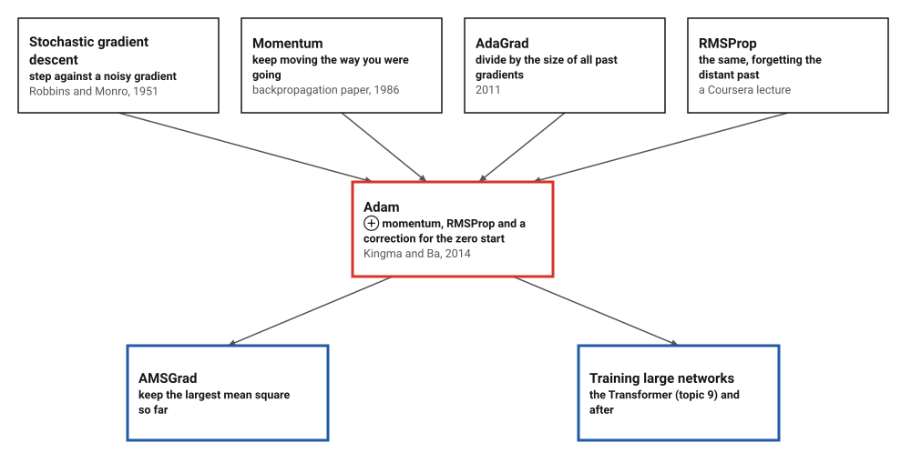
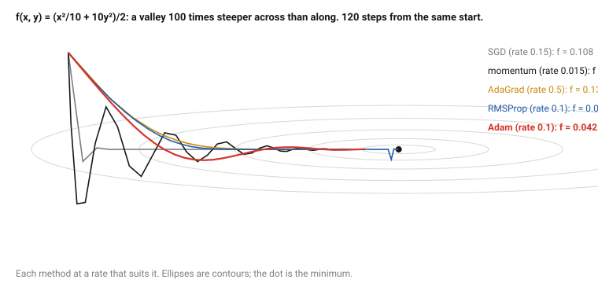
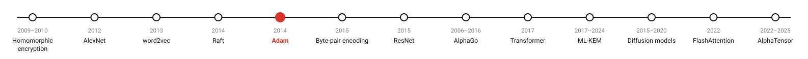
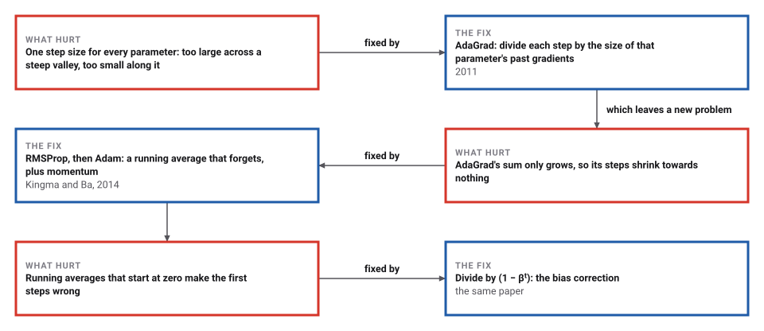
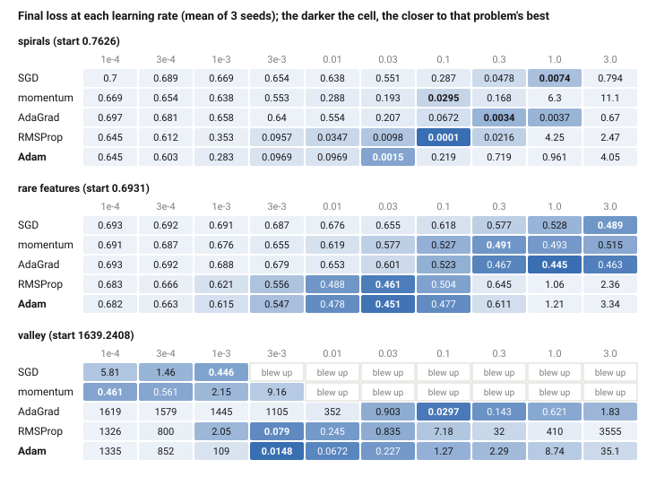

# Adam

*Era 9 · topic 5 · 2014* · [Era 9 index](../README.md) · [← Raft](../04-raft/README.md) · [Byte-Pair Encoding for Words →](../06-byte-pair-encoding/README.md) · [Interactive edition](adam.html) · [Program](../../../code/era-09-learning-at-scale/05-adam/)

> **Field note from the visiting historian.** I raced five ways of descending through three landscapes. None won everywhere. But SGD's best stride changed by a factor of 3000 from one landscape to another, and Adam's by 10; and when I measured one direction in different units, Adam walked exactly the same path.

| | |
|---|---|
| **When** | December 2014; ICLR 2015 |
| **Where** | Amsterdam and Toronto |
| **What hurt** | One step size for parameters of every scale |
| **The fix** | Per-parameter steps from running moments, bias-corrected |
| **Checked** | Path unchanged to 6.9 × 10⁻¹⁸ when a gradient is scaled by 1,000 |

## How ideas combined

A new algorithm is usually an older idea combined with a new one. Every neural network in this era is trained by stochastic gradient descent: nudge each weight against a gradient measured on a few examples. Momentum smooths the nudges; AdaGrad and RMSProp give every weight its own step size. Kingma and Ba combined momentum with RMSProp and added one correction, and called the result Adam, from *adaptive moment estimation*.

<picture>
  <source media="(prefers-color-scheme: dark)" srcset="assets/family-dark.svg">
  
</picture>
*Red: Adam. Blue: what came after. Dates for the four older methods are those Wikipedia gives.*

## Five ways down a valley

The valley is 100 times steeper across than along. Each method starts with a rate that suits it; the slider multiplies all of them. Click anywhere to move the start. Then tick the box that multiplies every gradient along y by 100, and see which methods notice.

<picture>
  <source media="(prefers-color-scheme: dark)" srcset="assets/paths-dark.svg">
  
</picture>
*In the interactive edition you can change the rates, the start and the units.*

## Era 9, learning at scale

<picture>
  <source media="(prefers-color-scheme: dark)" srcset="assets/era-timeline-dark.svg">
  
</picture>

## Each fix leaves a new pain

<picture>
  <source media="(prefers-color-scheme: dark)" srcset="assets/chain-dark.svg">
  
</picture>
*Read it as a snake: each new problem sits directly under the fix that exposed it.*

## Two running averages

**For every parameter**, with gradient g at step t, Adam keeps a running mean and a running mean square: m ← β₁m + (1 − β₁)g and v ← β₂v + (1 − β₂)g². The defaults are β₁ = 0.9 (about the last 10 gradients) and β₂ = 0.999 (about the last 1,000).

**The correction.** m and v start at 0, so for the first steps they are too small: after one step m = 0.1g and v = 0.001g². Dividing by (1 − β₁ᵗ) and (1 − β₂ᵗ) removes that bias exactly when the gradient is steady.

**The step** is α · m̂ / (√v̂ + ε), with α = 0.001 and ε = 10⁻⁸ by default. If a parameter's gradients are all 1,000 times larger, m̂ and √v̂ are both 1,000 times larger and the step does not change: Adam moves each parameter by about α, whatever the units its gradient happens to come in. When the gradient's sign keeps changing, m̂ is small next to √v̂ and the steps shrink.

> **Key idea.** Measure each parameter's gradient against its own recent history. A step of m̂ / √v̂ is a signal-to-noise ratio: large and confident when the gradient is steady, small when it is noise.

## Three problems, ten rates

**The race.** Five methods on three problems: a network with 337 weights learning two interleaved spirals (2,000 steps of 16 examples), logistic regression with 500 features where most features are rare (2,000 steps), and a 20-dimensional valley whose curvature ranges from 1 to 1,000, with noise in every gradient (1,000 steps). Each method was run at the ten learning rates 1e-4, 3e-4, 1e-3, 3e-3, 0.01, 0.03, 0.1, 0.3, 1.0, 3.0, three times each.

<picture>
  <source media="(prefers-color-scheme: dark)" srcset="assets/heat-dark.svg">
  
</picture>

Each method's best rate and the loss it reached, and how far apart the best rates of the three problems are:

| Method | Spirals: rate | loss | Rare: rate | loss | Valley: rate | loss | Best rates differ by × |
|---|---|---|---|---|---|---|---|
| SGD | 1.0 | 0.0074 | 3.0 | 0.4893 | 1e-3 | 0.4457 | 3000 |
| momentum | 0.1 | 0.0295 | 0.3 | 0.4911 | 1e-4 | 0.4614 | 3000 |
| AdaGrad | 0.3 | 0.0034 | 1.0 | 0.4447 | 0.1 | 0.0297 | 10 |
| RMSProp | 0.1 | 0.0001 | 0.03 | 0.4607 | 3e-3 | 0.0790 | 33 |
| **Adam** | **0.03** | **0.0015** | **0.03** | **0.4506** | **3e-3** | **0.0148** | **10** |

With its best rate, no method wins everywhere: RMSProp reached the lowest loss on the spirals, AdaGrad on rare features, Adam on the valley. The difference is in the tuning: SGD's best rate was 1.0 on one problem and 1e-3 on another, a factor of 3000; Adam's best rates differed by a factor of 10. On the valley SGD blew up at every rate above 1e-3 and momentum above 3e-3; Adam's steps stay close to its rate in size, and it never blew up.

Adam's default rate, 0.001, untuned, was not good enough in this many steps: 0.2828 on the spirals (best of all methods 0.0001), 0.6152 on rare features (0.4447), 109.4909 on the valley (0.0148). The defaults set the shape of the steps; the rate still needs choosing.

**The bias correction.** For a steady gradient, the uncorrected step divided by the corrected one is (1 − 0.9ᵗ)/√(1 − 0.999ᵗ): . The largest, 6.57, comes at step 12. On the spirals, after 300 steps:

| Rate | With the correction | Without |
|---|---|---|
| 3e-3 | 0.5731 | 0.3685 |
| 0.01 | 0.3737 | 0.1182 |
| 0.03 | 0.2777 | 0.0678 |
| **0.1** | **0.0302** | **0.5189** |

At small rates the uncorrected early steps act like a larger rate and happen to help; at rate 0.1 they are several times too long, the network is thrown off, and it has not recovered after 300 steps. This is the instability the paper describes: without the correction, β₂ near 1 makes the first steps far too large.

**Units do not matter.** Multiply the gradient of one parameter of the valley by 1,000 at every step, and run Adam (with ε = 0) for 500 steps: no parameter's path changed by more than 6.9 × 10⁻¹⁸. SGD fed the same gradients ended 78.26 away in that parameter.

**A convex problem Adam gets wrong.** Wikipedia: "Adam does not converge for all convex objectives." The program builds one: on every third step the gradient is +3, on the others −1, and x stays in [−1, 1]. On average the slope is +1/3, so the best x is −1. With β₁ = 0, β₂ = 0.1 and step 0.1/√t for 30,000 steps, SGD ends at -0.999 and Adam at **1.000**: the rare large gradient is divided by its own large size and counts no more than a common small one. AMSGrad, which divides by the largest mean square seen so far, ends at -1.000.

## A short paper with long defaults

Kingma (University of Amsterdam, OpenAI) and Ba (University of Toronto), first posted on 22 December 2014, "Published as a conference paper at ICLR 2015": a method based on "adaptive estimates of lower-order moments" that "has little memory requirements" and "is invariant to diagonal rescaling of the gradients"; defaults α = 0.001, β₁ = 0.9, β₂ = 0.999, ε = 10⁻⁸; "the name Adam is derived from adaptive moment estimation".

Wikipedia on what came before and after: momentum "appeared in Rumelhart, Hinton and Williams' paper on backpropagation learning"; AdaGrad was "first published in 2011"; RMSProp was "not published in an article but merely described in a Coursera lecture"; "The initial proof establishing the convergence of Adam was incomplete"; AMSGrad uses the "maximum of past squared gradients".

## Robbins and Monro's question, again

In 1951 Robbins and Monro asked how to find a root when every measurement is noisy, and answered with steps that shrink on a schedule. Adam answers the same question for millions of parameters at once, with a schedule each parameter sets for itself from its own noise.

> **Full circle.** Multiply one gradient by 1,000 and Adam's path moves by 6.9 × 10⁻¹⁸: the step depends on the gradient's ratio to its own history, not on its size.

## Before you read on

<details>
<summary><b>1.</b> With β₁ = 0.9, what is m after the first step if g = 5 and m started at 0? And m̂?</summary>

m = 0.1 × 5 = 0.5; m̂ = 0.5 / (1 − 0.9) = 5, the gradient itself.
</details>

<details>
<summary><b>2.</b> A parameter's gradient is always exactly 2. How far does Adam move it each step, with α = 0.001?</summary>

m̂ = 2 and √v̂ = 2 after correction, so the step is 0.001 · 2/2 = 0.001: α itself.
</details>

<details>
<summary><b>3.</b> Why can AdaGrad's steps become too small in a long training run?</summary>

It divides by the square root of the sum of all past squared gradients, which only grows.
</details>

<details>
<summary><b>4.</b> A weight belongs to a word seen once in 10,000 examples. Why might Adam suit it better than SGD?</summary>

When its gradient finally arrives, it is divided by a small √v̂, so the step is large; SGD would give it the same small rate as every common weight.
</details>

<details>
<summary><b>5.</b> If gradients flip between +1 and −1 every step, what happens to Adam's steps?</summary>

m̂ stays near 0 while √v̂ is near 1, so the steps become tiny: noise is recognized as noise.
</details>


## Where the evidence lives

| | Object | Where to see it | Licence |
|---|---|---|---|
| — | **Adam: A Method for Stochastic Optimization (2014)**. Kingma and Ba, arXiv:1412.6980. | [arXiv:1412.6980](https://arxiv.org/abs/1412.6980) | Drawn placeholder. |

## Every link was opened before it was listed

| Level | Link | Why |
|---|---|---|
| Start | [Optimization for Deep Learning (Momentum, RMSprop, AdaGrad, Adam)](https://www.youtube.com/watch?v=NE88eqLngkg) — DeepBean | The four methods side by side |
| Deeper | [Adam Optimization Algorithm (C2W2L08)](https://www.youtube.com/watch?v=JXQT_vxqwIs) — DeepLearningAI | Andrew Ng's lecture in the Deep Learning Specialization |
| Deeper | [Stochastic gradient descent](https://en.wikipedia.org/wiki/Stochastic_gradient_descent) — Wikipedia | From Robbins and Monro to Adam and AMSGrad |
| Scholar | [Adam: A Method for Stochastic Optimization](https://arxiv.org/abs/1412.6980) — D. P. Kingma, J. Ba (2014; ICLR 2015) | The algorithm, the defaults and the bias correction |

More, with certainty labels and the gaps we could not fill: [Era 9 reference catalog](https://github.com/vij658/AlgorithmEvolutionAtlas/blob/main/book/era-09-learning-at-scale/reference-catalog.md).

## The program behind every number here

[Adam.java](https://github.com/vij658/AlgorithmEvolutionAtlas/blob/main/code/era-09-learning-at-scale/05-adam/Adam.java) makes **8 checks**: the bias correction's first factor, that Adam's path ignores the scale of a gradient, the convex counterexample, and that Adam's best rate moves less than SGD's. Run it with `java Adam.java` (JDK 17 or newer). The heart of it:

```java
    void step(double[] w, double[] g) {
        t++;
        for (int i = 0; i < w.length; i++) {
            switch (kind) {
                case 0 -> w[i] -= lr * g[i];
                case 1 -> { m[i] = 0.9 * m[i] + g[i]; w[i] -= lr * m[i]; }
                case 2 -> { v[i] += g[i] * g[i]; w[i] -= lr * g[i] / (Math.sqrt(v[i]) + 1e-8); }
                case 3 -> { v[i] = 0.9 * v[i] + 0.1 * g[i] * g[i]; w[i] -= lr * g[i] / (Math.sqrt(v[i]) + 1e-8); }
                default -> {
                    m[i] = b1 * m[i] + (1 - b1) * g[i];
                    v[i] = b2 * v[i] + (1 - b2) * g[i] * g[i];
                    double mh = m[i], vh = v[i];
                    if (amsgrad) { vmax[i] = Math.max(vmax[i], v[i]); vh = vmax[i]; }
                    if (biasCorrection) { mh /= 1 - Math.pow(b1, t); vh /= 1 - Math.pow(b2, t); }
                    w[i] -= lr * mh / (Math.sqrt(vh) + eps);
                }
            }
        }
    }
```

