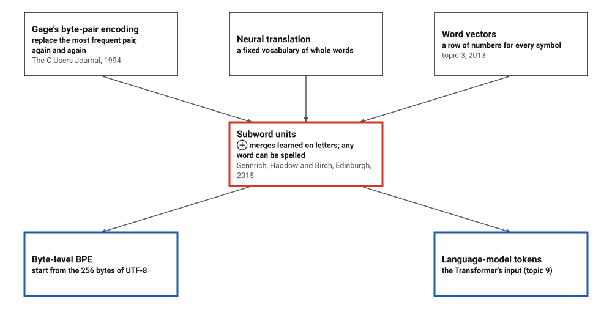
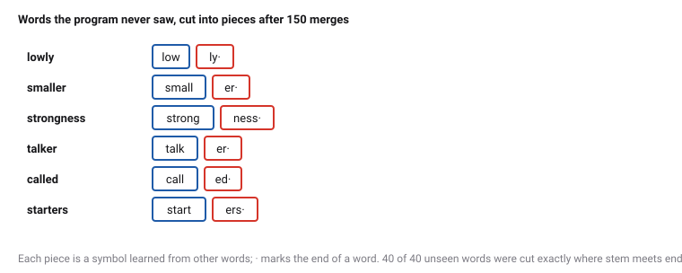
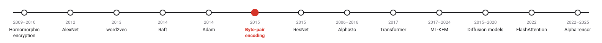
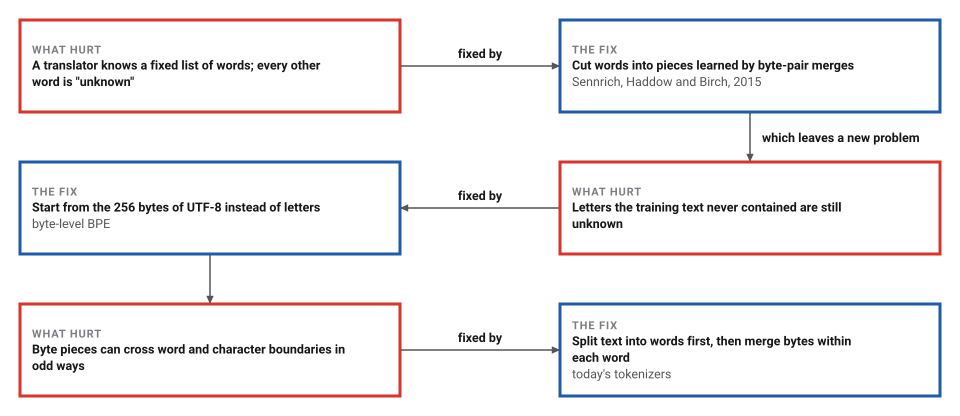

# Byte-Pair Encoding for Words

*Era 9 · topic 6 · 2015* · [Era 9 index](../README.md) · [← Adam](../05-adam/README.md) · [Residual Networks →](../07-residual-networks/README.md) · [Interactive edition](byte-pair-encoding.html) · [Program](../../../code/era-09-learning-at-scale/06-byte-pair-encoding/)

> **Field note from the visiting historian.** I gave the program 40 stems and their endings, and hid one ending of each stem. It counted pairs of letters and merged them, 150 times. Then I showed it the 40 words it had never seen. It cut 40 of them exactly between stem and ending, and it had never been told what an ending is.

| | |
|---|---|
| **When** | 1994; August 2015 |
| **Where** | The C Users Journal; University of Edinburgh |
| **What hurt** | Fixed vocabularies, and unknown words |
| **The fix** | Learned merges: pieces that spell any word |
| **Checked** | 40 of 40 unseen words cut at the stem |

## How ideas combined

A new algorithm is usually an older idea combined with a new one. In 1994 Philip Gage compressed files by replacing their most frequent pair of bytes with a spare byte, again and again. Twenty-one years later, neural translators still worked with a fixed list of whole words. Sennrich, Haddow and Birch at Edinburgh ran Gage's loop on words written as letters, and the pieces it learned became a vocabulary that can spell any word.

<picture>
  <source media="(prefers-color-scheme: dark)" srcset="assets/family-dark.svg">
  
</picture>
*Red: subword units. Blue: what came after.*

## Merge by merge

Each word is written as letters followed by the end symbol ·. Press *Merge once*: the most frequent pair of neighbouring symbols, counted over all the words, becomes one new symbol. Watch common endings form, then whole words. Type a word that is not in the text to see it cut into the pieces learned so far, or edit the text and start over.

<picture>
  <source media="(prefers-color-scheme: dark)" srcset="assets/unseen-dark.svg">
  
</picture>
*In the interactive edition you can run the merges yourself on any text.*

## Era 9, learning at scale

<picture>
  <source media="(prefers-color-scheme: dark)" srcset="assets/era-timeline-dark.svg">
  
</picture>

## Each fix leaves a new pain

<picture>
  <source media="(prefers-color-scheme: dark)" srcset="assets/chain-dark.svg">
  
</picture>
*Read it as a snake: each new problem sits directly under the fix that exposed it. The third row describes common practice, not a single paper.*

## Count, merge, repeat

**Learning.** Count every word in the training text. Write each as its letters and an end symbol ·, so that "low" is l o w ·. Count every pair of neighbouring symbols, each word weighted by how often it occurs. Merge the most frequent pair everywhere into a new symbol, write it down, and count again. Stop after a chosen number of merges: the vocabulary is the letters plus one symbol per merge.

**Cutting a word.** Write it as letters and ·; then, among the merges that apply, apply the one learned earliest, and repeat until none applies. A frequent word ends as one symbol; a rare one as a few pieces; a word made of letters never seen keeps those letters as they are.

**Why the end symbol.** "er" at the end of a word (newer, wider) is a different thing from "er" inside one (very); the end symbol keeps them apart, and lets the pieces be joined back into words exactly.

> **Key idea.** Let the data choose the vocabulary. A fixed number of merges gives a fixed-size vocabulary, yet every word can still be spelled, because the letters themselves remain in it.

## Forty stems, forty unseen words

**Gage's compressor** on Wikipedia's example: aaabdaaabac → ZabdZabac → ZYdZYac → XdXac, with the table Z = aa, Y = ab, X = ZY. At each step the pair replaced was a most frequent one: aa 2 times (tied with 1 other), ab 2 times (tied with 1 other), ZY 2 times. 11 symbols became 5, and the table, applied backwards, restores the text exactly.

**The paper's Figure 1** learns from the four words low, lowest, newer, wider, and shows the merges r ·, l o, lo w, e r·. The program checks that each was a most frequent pair when it was made; all four had count 2, tied with 4, 3, 2 and 0 other pairs. Ties may be broken either way: this program, taking the pair it saw first, learns l o, lo w, e r, er · instead. Afterwards the paper's four words read low ·, low e s t ·, n e w er·, w i d er·.

**A corpus.** 129,831 words in 20,000 sentences, built from 40 stems (low, walk, ...) with their endings (-er, -est, -ly, -ness; -s, -ed, -ing, -er, -ers): 198 distinct words over 24 letters. One ending of every stem was held out, so 40 words never appear, among them lowly, newest, widely, older, fastness, slowness. The first merges: the first 20: t + ·, e + s, s + ·, i + g, ig + h, es + t·, i + n, e + ·, h + igh, high + est·, e + r, g + ·.

| Merges | Symbols per word | Vocabulary |
|---|---|---|
| 0 | 5.88 | 25 |
| 10 | 4.21 | 35 |
| 25 | 3.28 | 50 |
| 50 | 2.54 | 75 |
| **100** | **1.61** | **125** |
| 200 | 1.12 | 225 |
| 300 | 1.01 | 325 |

Giving every distinct word of this corpus its own symbol would need 198 symbols, and would still fail on the next new word.

**Words never seen.** After 150 merges, the 40 held-out words are cut into 2.43 pieces on average, and **40 of 40** are cut exactly where the stem meets the ending: lowly = low + ly·; smaller = small + er·; strongness = strong + ness·; talker = talk + er·; called = call + ed·; starters = start + ers·. No grammar was given; the boundaries come from counting.

**Letters against bytes.** A vocabulary built from this corpus's 24 letters cannot write a letter it never saw; a byte vocabulary starts from all 256 values of UTF-8 and can write anything:

| Text | Unknown letters | UTF-8 bytes | Byte tokens |
|---|---|---|---|
| slowest | 0 | 7 | 3 |
| naïve | 1 | 6 | 6 |
| café | 1 | 5 | 5 |
| Zürich | 2 | 7 | 7 |
| 日本語 | 3 | 9 | 9 |
| 😀 ok | 1 | 7 | 7 |
| Ωmega | 1 | 6 | 6 |

All 7 of 7 strings decode from their byte tokens back to exactly the original text. Characters the merges never met simply stay as single bytes, three or four per character.

## Edinburgh, 2015

Sennrich, Haddow and Birch (School of Informatics, University of Edinburgh; arXiv, first version 31 August 2015): translation is "an open-vocabulary problem"; byte-pair encoding is "a simple data compression technique"; words end in a "special end-of-word symbol". Their Algorithm 1 is a minimal Python implementation; their experiments used 59,500 merge operations (89,500 for a vocabulary shared by both languages), and subword models improved on a back-off dictionary baseline "by up to 1.1 and 1.3 BLEU, respectively" for English→German and English→Russian.

Wikipedia: byte-pair encoding was "first described in 1994 by Philip Gage"; the original "replaces the highest-frequency pair of bytes with a new byte that was not contained in the initial dataset"; "A slightly modified version of the algorithm is used in large language model tokenizers"; byte-level BPE "converts the text into UTF-8 first". GPT-3.5 and GPT-4 use a vocabulary of 100,258 tokens.

## A compressor becomes a reader

Gage wanted fewer bytes. The same loop, run on text, finds the pieces a language is built from, and those pieces became the units in which today's language models read and write. The algorithm did not change; the question asked of its output did.

> **Full circle.** Nobody told the program that -ness is an ending. 40 of 40 words it had never seen were cut exactly there.

## Before you read on

<details>
<summary><b>1.</b> Apply Gage's method by hand to abababcab. Which pair goes first?</summary>

ab, 4 times: XXXcX with X = ab. Now every pair occurs only once (XXX holds XX once without overlap), so another replacement would save nothing and the compressor stops.
</details>

<details>
<summary><b>2.</b> Why add · to the end of each word?</summary>

So that endings and word-internal pieces are different symbols, and the pieces can be joined back into the original words.
</details>

<details>
<summary><b>3.</b> A vocabulary of 30 letters and 1,000 merges: how many symbols?</summary>

1,030: each merge adds exactly one symbol.
</details>

<details>
<summary><b>4.</b> Why are the merges replayed in the order learned when cutting a new word?</summary>

That reproduces how the training words were cut, so a new word gets the same pieces a training word with the same letters would have.
</details>

<details>
<summary><b>5.</b> A byte vocabulary meets a Chinese character it never saw. What happens?</summary>

It is written as its three UTF-8 bytes, which are always in the vocabulary; nothing is unknown.
</details>


## Where the evidence lives

| | Object | Where to see it | Licence |
|---|---|---|---|
| — | **Neural Machine Translation of Rare Words with Subword Units (2015)**. Sennrich, Haddow and Birch, arXiv:1508.07909. | [arXiv:1508.07909 (PDF)](https://arxiv.org/pdf/1508.07909) | Drawn placeholder. |

## Every link was opened before it was listed

| Level | Link | Why |
|---|---|---|
| Start | [Byte Pair Encoding Tokenization](https://www.youtube.com/watch?v=HEikzVL-lZU) — Hugging Face | A short lesson from the Hugging Face course |
| Start | [Byte-pair encoding](https://en.wikipedia.org/wiki/Byte-pair_encoding) — Wikipedia | The 1994 compressor and today's tokenizers |
| Deeper | [Let's build the GPT Tokenizer](https://www.youtube.com/watch?v=zduSFxRajkE) — Andrej Karpathy | A byte-level tokenizer written from scratch |
| Scholar | [Neural Machine Translation of Rare Words with Subword Units](https://arxiv.org/pdf/1508.07909) — R. Sennrich, B. Haddow, A. Birch (2015–2016) | Merges learned on words, and Algorithm 1 |

More, with certainty labels and the gaps we could not fill: [Era 9 reference catalog](https://github.com/vij658/AlgorithmEvolutionAtlas/blob/main/book/era-09-learning-at-scale/reference-catalog.md).

## The program behind every number here

[BytePairEncoding.java](https://github.com/vij658/AlgorithmEvolutionAtlas/blob/main/code/era-09-learning-at-scale/06-byte-pair-encoding/BytePairEncoding.java) makes **196 checks**: Wikipedia's example and the paper's figure as valid runs, that the pieces always spell the word, that unseen words are cut at the stem, and that bytes decode exactly. Run it with `java BytePairEncoding.java` (JDK 17 or newer). The heart of it:

```java
static List<Pair> learn(Map<String, Long> words, int merges, Map<List<String>, Long>[] finalVocab) {
    Map<List<String>, Long> vocab = new LinkedHashMap<>();
    for (Map.Entry<String, Long> e : words.entrySet()) vocab.put(letters(e.getKey()), e.getValue());
    List<Pair> out = new ArrayList<>();
    for (int k = 0; k < merges; k++) {
        Pair p = best(pairCounts(vocab));
        if (p == null) break;
        out.add(p);
        vocab = mergeVocab(vocab, p);
    }
    if (finalVocab != null) finalVocab[0] = vocab;
    return out;
}

/** Cut a word by replaying the merges: always apply the earliest-learned merge that occurs, until none does. */
static List<String> segment(List<String> w, Map<Pair, Integer> rank) {
    while (true) {
        int bestR = Integer.MAX_VALUE; Pair bp = null;
        for (int i = 0; i + 1 < w.size(); i++) {
            Integer r = rank.get(new Pair(w.get(i), w.get(i + 1)));
            if (r != null && r < bestR) { bestR = r; bp = new Pair(w.get(i), w.get(i + 1)); }
        }
        if (bp == null) return w;
        w = applyMerge(w, bp);
    }
}
```

