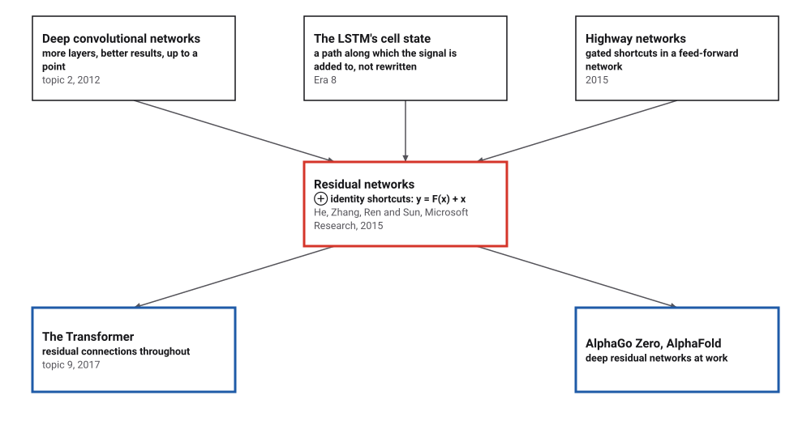
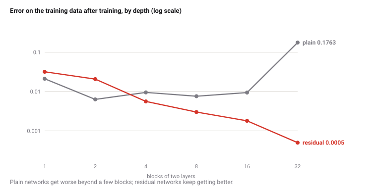
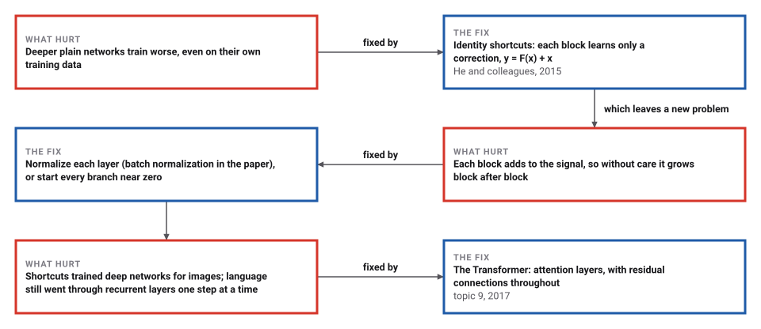

# Residual Networks

*Era 9 · topic 7 · 2015* · [Era 9 index](../README.md) · [← Byte-Pair Encoding for Words](../06-byte-pair-encoding/README.md) · [Monte Carlo Tree Search and AlphaGo →](../08-monte-carlo-tree-search/README.md) · [Interactive edition](residual-networks.html) · [Program](../../../code/era-09-learning-at-scale/07-residual-networks/)

> **Field note from the visiting historian.** I stacked layers on a small network and taught it a wavy surface. Two blocks did well. Thirty-two blocks did 28.1 times worse, on the very points they were taught. Then I let every block add its input back to its output, and the thirty-two-block network became the best of all.

| | |
|---|---|
| **When** | December 2015 |
| **Where** | Microsoft Research |
| **What hurt** | Deeper plain networks trained worse |
| **The fix** | Identity shortcuts: y = F(x) + x |
| **Checked** | 32 blocks: plain 0.1763, residual 0.0005 |

## How ideas combined

A new algorithm is usually an older idea combined with a new one. After 2012 (topic 2) deeper networks did better, up to a point, and then worse. The LSTM (Era 8) had already shown that a signal survives many steps if it is carried along and added to rather than rewritten each time; highway networks applied a gated version of that to feed-forward networks. He, Zhang, Ren and Sun at Microsoft Research removed the gate: every block simply adds its input to its output.

<picture>
  <source media="(prefers-color-scheme: dark)" srcset="assets/family-dark.svg">
  
</picture>
*Red: residual networks. Blue: where the shortcut went next.*

## Deeper and worse, or deeper and better

Choose a depth. On the left are the program's training runs: plain against residual, the same data, optimizer and steps. On the right, your browser builds a fresh random network of that depth and measures how much gradient reaches each block. Try 32 blocks, then press *New random weights*.

<picture>
  <source media="(prefers-color-scheme: dark)" srcset="assets/depth-dark.svg">
  
</picture>
*In the interactive edition you can choose the depth and see the training curves and gradients.*

## Era 9, learning at scale

<picture>
  <source media="(prefers-color-scheme: dark)" srcset="assets/era-timeline-dark.svg">
  
</picture>

## Each fix leaves a new pain

<picture>
  <source media="(prefers-color-scheme: dark)" srcset="assets/chain-dark.svg">
  
</picture>
*Read it as a snake: each new problem sits directly under the fix that exposed it. Starting branches at zero is what this program does; the paper normalizes instead.*

## Learn the correction, not the whole

**A plain block** of two layers maps its input h to relu(W₂ relu(W₁h + b₁) + b₂). A stack of them has to carry everything the network knows through every layer; if a block should change nothing, its weights must learn to reproduce their input exactly, which is hard for layers of random numbers and rectifiers.

**A residual block** maps h to relu(h + F(h)), where F is the same two layers. The block only learns a correction F(h) = H(h) − h to its input. If nothing needs to change, F can shrink to zero, and setting W₂ = 0 passes the signal through exactly. The shortcut has no weights: the paper's words, it adds "neither extra parameter nor computational complexity".

**Gradients flow along the shortcut too.** Going backwards, each block passes its output's gradient straight to its input, plus whatever comes through F. In a plain stack, the gradient must pass through every layer's weights and rectifiers in turn, and it can shrink (or grow) by a factor at each one.

> **Key idea.** Make doing nothing the easiest thing for a block to do. Then adding blocks cannot make the network worse at the start, and each block only has to learn what is still missing.

## Thirty-two blocks

**The task**: fit f(x, y) = sin 3x · cos 3y + 0.5 sin 5xy at 512 random points (the values have variance 0.3440). Every network has hidden layers 12 wide and is trained with Adam (topic 5), rate 0.001, for 1,500 steps of 32 points; each number is the mean of 2 runs. The error is on the training points themselves, so overfitting cannot explain it. Plain blocks start with random (He) weights; residual blocks start with their second layer at zero, so that each starts as the identity. The program's backpropagation agrees with finite differences to 1.6 × 10⁻⁸.

| Blocks | Weight layers | Parameters | Plain error | Residual error | Gradient at block 1, plain | residual |
|---|---|---|---|---|---|---|
| 1 | 4 | 361 | 0.0211 | 0.0318 | 7.4 × 10⁻¹ | 6.3 × 10⁻¹ |
| 2 | 6 | 673 | 0.0063 | 0.0207 | 3.8 × 10⁻¹ | 2.1 × 10⁻¹ |
| 4 | 10 | 1,297 | 0.0095 | 0.0056 | 1.2 × 10⁻¹ | 4.4 × 10⁻¹ |
| 8 | 18 | 2,545 | 0.0076 | 0.0030 | 1.8 × 10⁻¹ | 3.9 × 10⁻¹ |
| 16 | 34 | 5,041 | 0.0094 | 0.0018 | 1.7 × 10⁻² | 4.4 × 10⁻¹ |
| **32** | **66** | **10,033** | **0.1763** | **0.0005** | **1.3 × 10⁻⁴** | **2.7 × 10⁻¹** |

The best plain network had 2 blocks (0.0063). With 32 blocks the plain network's error was 0.1763, **28.1 times worse** on its own training data: the degradation problem. The residual network's error kept falling with depth, to 0.0005 at 32 blocks. At the start of training, the gradient reaching the first block of the 32-block plain network was 1.3 × 10⁻⁴, against 7.4 × 10⁻¹ for one block.

**The shortcut alone is not enough.** A residual network started with the same random weights as the plain one adds a full random correction in every block, and the signal grows block after block. At the start of training:

| Blocks | Error at the start | Gradient at block 1 |
|---|---|---|
| 1 | 1.21 | 1.7 |
| 2 | 0.813 | 1.0 |
| 4 | 11.3 | 2.2 × 10¹ |
| 8 | 138 | 2.4 × 10² |
| 16 | 8.10 × 10³ | 1.1 × 10⁴ |
| **32** | **8.52 × 10⁸** | **1.5 × 10⁹** |

The paper's networks avoid this by normalizing every layer (batch normalization); this program avoids it by starting every branch at zero. Either way, the shortcut only helps if the corrections start small.

**A deeper network can copy a shallower one.** A 4-block residual network trained for 800 steps (error 0.0150) was extended to 20 blocks whose second weights are zero. Over all 512 points the largest difference in output was **0.0**: exactly the same function. The same weights in a plain network give every input the same output (error 0.3444): zero weights there do not pass the signal, they cut it.

## Microsoft Research, December 2015

He, Zhang, Ren and Sun (Microsoft Research, submitted 10 December 2015): "with the network depth increasing, accuracy gets saturated (which might be unsurprising) and then degrades rapidly. Unexpectedly, such degradation is not caused by overfitting"; "we let the stacked nonlinear layers fit another mapping of F(x) := H(x)−x"; "the 34-layer plain net has higher training error throughout the whole training procedure". On ImageNet validation (10-crop, top-1 error): plain 18 layers 27.94%, plain 34 layers 28.54%; ResNet-18 27.88%, ResNet-34 25.03%. Networks of up to 152 layers; an ensemble reached 3.57% error on the ImageNet test set and won the ILSVRC 2015 classification task.

Wikipedia: "ResNet is equivalent to an open-gated highway network"; an LSTM's cell state can "function as a generalized residual connection"; "All transformer architectures include residual connections"; residual connections ease vanishing gradients "to some extent", but vanishing gradients are not the root cause of the degradation problem.

## The LSTM's trick, turned sideways

In 1997 the LSTM (Era 8) let a signal cross hundreds of time steps by adding to a cell rather than rewriting it. A residual network does the same thing across layers instead of across time: the signal is carried forward and each block adds a correction. Two years later the Transformer (topic 9) was built with residual connections throughout; Wikipedia: "All transformer architectures include residual connections".

> **Full circle.** Thirty-two plain blocks trained 28.1 times worse than two. Thirty-two residual blocks trained better than any plain network: 0.0005.

## Before you read on

<details>
<summary><b>1.</b> A residual block's branch outputs F(h) = 0. What does the block compute, if h ≥ 0?</summary>

relu(h + 0) = h: the identity.
</details>

<details>
<summary><b>2.</b> Why is higher training error, not test error, the telling sign of degradation?</summary>

Overfitting raises test error while lowering training error. Higher training error means the optimizer failed to find a solution a deeper network could represent.
</details>

<details>
<summary><b>3.</b> In a plain stack, each layer multiplies the gradient by about 0.75. How much reaches the first of 64 layers?</summary>

0.75⁶⁴, about 10⁻⁸: almost nothing.
</details>

<details>
<summary><b>4.</b> How many extra parameters does an identity shortcut add?</summary>

None: it adds the input as it is.
</details>

<details>
<summary><b>5.</b> Why might a residual network started with full random weights in every branch blow up?</summary>

Each block adds a random correction of about the size of its input, so the signal can roughly double per block: 32 blocks, a factor of billions.
</details>


## Where the evidence lives

| | Object | Where to see it | Licence |
|---|---|---|---|
| — | **Deep Residual Learning for Image Recognition (2015)**. He, Zhang, Ren and Sun, arXiv:1512.03385. | [arXiv:1512.03385](https://arxiv.org/abs/1512.03385v1) | Drawn placeholder. |

## Every link was opened before it was listed

| Level | Link | Why |
|---|---|---|
| Start | [Residual neural network](https://en.wikipedia.org/wiki/Residual_neural_network) — Wikipedia | The degradation problem, highway networks and where residuals went next |
| Deeper | [[Classic] Deep Residual Learning for Image Recognition (Paper Explained)](https://www.youtube.com/watch?v=GWt6Fu05voI) — Yannic Kilcher | A walk through the paper |
| Scholar | [Deep Residual Learning for Image Recognition](https://www.youtube.com/watch?v=C6tLw-rPQ2o) — ComputerVisionFoundation Videos | The conference talk, on the channel of the Computer Vision Foundation |
| Scholar | [Deep Residual Learning for Image Recognition](https://arxiv.org/pdf/1512.03385) — K. He, X. Zhang, S. Ren, J. Sun (2015) | The degradation experiment and the residual block |

More, with certainty labels and the gaps we could not fill: [Era 9 reference catalog](https://github.com/vij658/AlgorithmEvolutionAtlas/blob/main/book/era-09-learning-at-scale/reference-catalog.md).

## The program behind every number here

[ResidualNetworks.java](https://github.com/vij658/AlgorithmEvolutionAtlas/blob/main/code/era-09-learning-at-scale/07-residual-networks/ResidualNetworks.java) makes **8 checks**: backpropagation against finite differences, the degradation of the deepest plain network, the residual networks improving with depth, and the exact copy of a shallower network. Run it with `java ResidualNetworks.java` (JDK 17 or newer). The heart of it:

```java
    /** Forward pass; keeps the activations in acts when it is not null (for backpropagation). */
    double forward(double[] x, double[][] h, double[][] u) {
        double[] cur = new double[W];
        for (int j = 0; j < W; j++) cur[j] = Math.max(0, p[inW + 2 * j] * x[0] + p[inW + 2 * j + 1] * x[1] + p[inB + j]);
        if (h != null) h[0] = cur.clone();
        for (int b = 0; b < B; b++) {
            double[] mid = new double[W], nxt = new double[W];
            for (int j = 0; j < W; j++) {
                double s = p[b1(b) + j];
                for (int k = 0; k < W; k++) s += p[w1(b) + j * W + k] * cur[k];
                mid[j] = Math.max(0, s);
            }
            for (int j = 0; j < W; j++) {
                double s = p[b2(b) + j] + (residual ? cur[j] : 0);
                for (int k = 0; k < W; k++) s += p[w2(b) + j * W + k] * mid[k];
                nxt[j] = Math.max(0, s);
            }
            if (u != null) u[b] = mid;
            cur = nxt;
            if (h != null) h[b + 1] = cur.clone();
        }
        double y = p[outB];
        for (int j = 0; j < W; j++) y += p[outW + j] * cur[j];
        return y;
    }

    /** Adds the gradient of 0.5 (f(x) - y)^2 to g; returns the squared error. */
    double backward(double[] x, double y, double[] g) {
        double[][] h = new double[B + 1][], u = new double[B][];
        double f = forward(x, h, u), e = f - y;
        g[outB] += e;
        double[] d = new double[W]; // gradient with respect to the current block output (after its relu)
        for (int j = 0; j < W; j++) { g[outW + j] += e * h[B][j]; d[j] = e * p[outW + j]; }
        for (int b = B - 1; b >= 0; b--) {
            double[] cur = h[b], mid = u[b], out = h[b + 1];
            double[] ds = new double[W]; // through the relu after the addition
            for (int j = 0; j < W; j++) ds[j] = out[j] > 0 ? d[j] : 0;
            double[] dmid = new double[W], dcur = new double[W];
            for (int j = 0; j < W; j++) {
                g[b2(b) + j] += ds[j];
                for (int k = 0; k < W; k++) { g[w2(b) + j * W + k] += ds[j] * mid[k]; dmid[k] += ds[j] * p[w2(b) + j * W + k]; }
                if (residual) dcur[j] += ds[j];
            }
            for (int j = 0; j < W; j++) {
                double dm = mid[j] > 0 ? dmid[j] : 0;
                g[b1(b) + j] += dm;
                for (int k = 0; k < W; k++) { g[w1(b) + j * W + k] += dm * cur[k]; dcur[k] += dm * p[w1(b) + j * W + k]; }
            }
            d = dcur;
        }
        for (int j = 0; j < W; j++) {
            double dj = h[0][j] > 0 ? d[j] : 0;
            g[inW + 2 * j] += dj * x[0]; g[inW + 2 * j + 1] += dj * x[1]; g[inB + j] += dj;
        }
        return e * e;
    }
```

