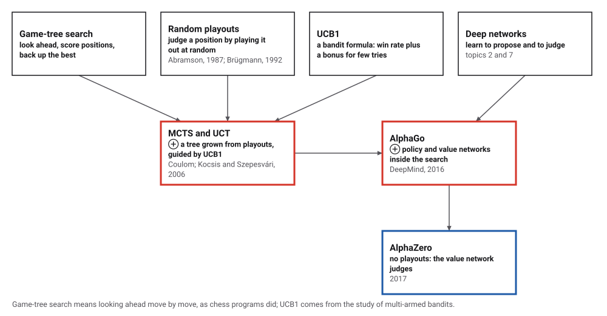
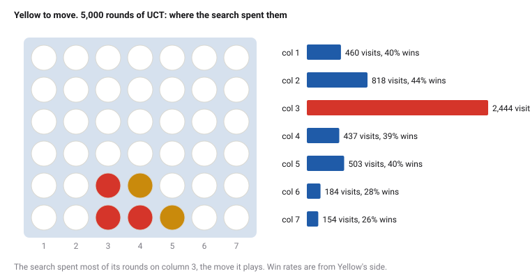
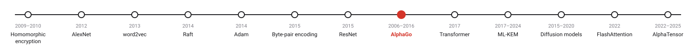
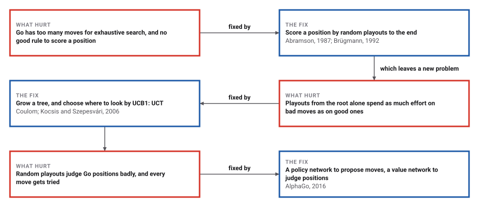

# Monte Carlo Tree Search and AlphaGo

*Era 9 · topic 8 · 2006–2016* · [Era 9 index](../README.md) · [← Residual Networks](../07-residual-networks/README.md) · [The Transformer →](../09-transformer/README.md) · [Interactive edition](monte-carlo-tree-search.html) · [Program](../../../code/era-09-learning-at-scale/08-monte-carlo-tree-search/)

> **Field note from the visiting historian.** I gave the program only the rules of two games. To judge a move it played the rest of the game at random, again and again, and spent its effort where the results were promising or uncertain. In tic-tac-toe, with 3,000 rounds, it found a best move in 418 of 418 positions where a wrong one was possible.

| | |
|---|---|
| **When** | 1987 to 2006; AlphaGo 2016 |
| **Where** | Abramson, Brügmann, Coulom, Kocsis and Szepesvári; DeepMind |
| **What hurt** | Go's tree was too large, and no rule could score a position |
| **The fix** | Random playouts, a growing tree and UCB1; then networks |
| **Checked** | 418 of 418 hard tic-tac-toe positions right |

## How ideas combined

A new algorithm is usually an older idea combined with a new one. Chess programs searched a tree of moves and scored positions with hand-written rules. Go has too many moves for that and no good rule. Random playouts gave a crude score; in 2006 Coulom grew a tree from them, and Kocsis and Szepesvári chose where to look with UCB1, a formula from the study of gambling machines. Ten years later DeepMind put two neural networks inside that search.

<picture>
  <source media="(prefers-color-scheme: dark)" srcset="assets/family-dark.svg">
  
</picture>
*Red: Monte Carlo tree search and AlphaGo. Blue: what came after.*

## Play against the search

The computer knows only the rules of Connect Four. For each move it runs the chosen number of rounds of UCT with random playouts, then plays its most visited column; the bars show where its rounds went. Beat it at 50 rounds, then try 2,000.

<picture>
  <source media="(prefers-color-scheme: dark)" srcset="assets/position-dark.svg">
  
</picture>
*In the interactive edition you can play Connect Four against the search.*

## Era 9, learning at scale

<picture>
  <source media="(prefers-color-scheme: dark)" srcset="assets/era-timeline-dark.svg">
  
</picture>

## Each fix leaves a new pain

<picture>
  <source media="(prefers-color-scheme: dark)" srcset="assets/chain-dark.svg">
  
</picture>
*Read it as a snake: each new problem sits directly under the fix that exposed it.*

## Four steps, many times

**Selection.** Start at the root. While every move from the current node has been tried, go to the child with the largest score w/n + c·√(ln N / n), where w is the child's wins, n its visits, N the parent's visits and c = √2 here. The first term favours moves that have done well; the second, moves tried only a few times. This is the standard UCB1 form; the sources opened for this page describe it without printing it.

**Expansion.** Add one untried move as a new node. **Simulation.** From there, play random moves to the end of the game. **Backpropagation.** Walk back to the root, adding one visit to every node on the path and a win (or half for a draw) to every node whose move was made by the winner.

**Choosing.** After the last round, play the root's most visited move. The bonus term shrinks as a move is visited, so moves that keep winning keep getting rounds and the rest are tried just often enough not to be overlooked.

**AlphaGo's changes.** A policy network, trained on expert games, gives each move a prior probability, and the search tries likely moves first and longest. A value network judges positions, alone or together with playouts. The program here has no networks; it tests the first change with a hand-written prior that prefers central columns.

> **Key idea.** Spend the simulations where they are most informative: on the moves that look best, and on the moves you know least about. No evaluation rule is needed; the game's own ending is the judge.

## Checked against perfect play

**Tic-tac-toe, solved.** The program computes the exact value of all 4,520 positions that can arise in play (the empty board is a draw), then gives UCT 600 of them at random. A move counts as right if it keeps the best result available. The harder test is the positions where some move is wrong:

| Rounds per move | Best move, all positions | Best move where a wrong one exists |
|---|---|---|
| 30 | 570 of 600 | 388 of 418 |
| 300 | 597 of 600 | 415 of 418 |
| **3,000** | **600 of 600** | **418 of 418** |

**Connect Four** (7 columns, 6 rows; each side moves first in half the games). UCT with 200 rounds against random moves: 40 wins, 0 draws, 0 losses. UCT with 2,000 rounds against UCT with 500: 44 wins, 1 draws, 15 losses. More search is stronger.

**A prior.** Give the search a hand-written prior over the columns, 1, 2, 3, 4, 3, 2, 1 (out of 16), and select by win rate + 1.5 · prior · √N / (1 + n), the shape of AlphaGo's selection rule. At an equal 500 rounds, against plain UCT: 38 wins, 4 draws, 18 losses. A prior that proposes sensible moves makes the same number of rounds go further; AlphaGo's came from a network trained on 30 million expert moves.

**Where the rounds go.** In one position (Red has played 4, 3, 3 and Yellow 4, 5), 5,000 rounds split as follows; the search plays column 3:

| Column | Visits | Yellow's wins in playouts |
|---|---|---|
| 1 | 460 | 40% |
| 2 | 818 | 44% |
| **3** | **2,444** | **51%** |
| 4 | 437 | 39% |
| 5 | 503 | 40% |
| 6 | 184 | 28% |
| 7 | 154 | 26% |

## From 1987 to Seoul

Wikipedia: Abramson's 1987 thesis used random playouts in an expected-outcome model; Brügmann used Monte Carlo methods in a Go program in 1992; in 2006 Coulom coined the name "Monte Carlo tree search", and Kocsis and Szepesvári developed UCT from UCB1; each round has four steps, selection, expansion, simulation and backpropagation; AlphaGo beat Lee Sedol in March 2016 in "a five-game match with a final score of four games to one"; AlphaZero "replaces the simulation step with an evaluation based on a neural network".

Silver and Hassabis, 27 January 2016: Go's search space is "more than a googol times larger than chess"; the policy network was trained on 30 million moves "until it could predict the human move 57% of the time" (the previous record was 44%); AlphaGo "won all but one of its 500 games" against other Go programs and beat the European champion Fan Hui "by 5 games to 0".

## Monte Carlo comes home

The Monte Carlo method was born at Los Alamos (Era 4, topic 10) to estimate what could not be calculated, by sampling. Sixty years later it became a way to choose moves in the hardest board game: sample the future, and let the samples decide where to sample next.

> **Full circle.** Knowing nothing but the rules, UCT with 3,000 rounds found a best move in 418 of 418 tic-tac-toe positions where a wrong move was possible.

## Before you read on

<details>
<summary><b>1.</b> A child has 6 wins in 10 visits, its parent 100 visits. What is its UCB1 score with c = √2?</summary>

0.6 + √2 · √(ln 100 / 10) = 0.6 + 1.414 · 0.679 ≈ 1.56.
</details>

<details>
<summary><b>2.</b> Why play the most visited move rather than the one with the best win rate?</summary>

A move with a high win rate from few visits may be lucky; many visits mean the search kept finding it good.
</details>

<details>
<summary><b>3.</b> What does the bonus term do to a move that is never visited again?</summary>

Its bonus grows slowly with the parent's visits (ln N), so it will eventually be tried again.
</details>

<details>
<summary><b>4.</b> Why can random playouts misjudge a position?</summary>

Random players miss threats a real player would see; a position that is lost against good play can win many random games.
</details>

<details>
<summary><b>5.</b> What did AlphaZero remove from the four steps?</summary>

The simulation: a value network judges the new position instead of random playouts.
</details>


## Where the evidence lives

| | Object | Where to see it | Licence |
|---|---|---|---|
| — | **AlphaGo: Mastering the ancient game of Go with Machine Learning (2016)**. Silver and Hassabis, Google Research blog. | [Google Research blog](https://research.google/blog/alphago-mastering-the-ancient-game-of-go-with-machine-learning/) | Drawn placeholder. |

## Every link was opened before it was listed

| Level | Link | Why |
|---|---|---|
| Start | [AlphaGo - The Movie \| Full award-winning documentary](https://www.youtube.com/watch?v=WXuK6gekU1Y) — Google DeepMind | The Lee Sedol match, on DeepMind's own channel |
| Start | [AlphaGo: Mastering the ancient game of Go with Machine Learning](https://research.google/blog/alphago-mastering-the-ancient-game-of-go-with-machine-learning/) — D. Silver, D. Hassabis, Google Research blog (2016) | The announcement |
| Deeper | [Monte Carlo Tree Search](https://www.youtube.com/watch?v=UXW2yZndl7U) — John Levine | The four steps and UCT, worked on a whiteboard |
| Deeper | [Monte Carlo tree search](https://en.wikipedia.org/wiki/Monte_Carlo_tree_search) — Wikipedia | History from 1987, the four steps and UCT |

More, with certainty labels and the gaps we could not fill: [Era 9 reference catalog](https://github.com/vij658/AlgorithmEvolutionAtlas/blob/main/book/era-09-learning-at-scale/reference-catalog.md).

## The program behind every number here

[MonteCarloTreeSearch.java](https://github.com/vij658/AlgorithmEvolutionAtlas/blob/main/code/era-09-learning-at-scale/08-monte-carlo-tree-search/MonteCarloTreeSearch.java) makes **6 checks**: UCT's moves against the exact solution of tic-tac-toe, wins against random play and weaker search, and the effect of a prior. Run it with `java MonteCarloTreeSearch.java` (JDK 17 or newer). The heart of it:

```java
/** Returns the root after the given number of rounds. prior != null switches to AlphaGo-style selection with it. */
static Node search(Game root, int rounds, Random r, double[] prior) {
    Node top = new Node(null, -1, 3 - root.toMove(), root);
    for (int it = 0; it < rounds; it++) {
        Node n = top; Game g = root.copy();
        // 1. selection
        while (n.nu == 0 && !n.kids.isEmpty()) {
            Node best = null; double bs = -1e18;
            for (Node k : n.kids) {
                double s = prior == null
                        ? k.wins / k.visits + C * Math.sqrt(Math.log(n.visits) / k.visits)
                        : k.wins / k.visits + 1.5 * k.prior * Math.sqrt(n.visits) / (1 + k.visits);
                if (s > bs) { bs = s; best = k; }
            }
            n = best; g.play(n.move);
        }
        // 2. expansion: a random untried move, or with a prior, the untried move the prior likes most
        if (n.nu > 0) {
            int i;
            if (prior == null) i = r.nextInt(n.nu);
            else { i = 0; for (int j = 1; j < n.nu; j++) if (prior[n.untried[j]] > prior[n.untried[i]]) i = j; }
            int m = n.untried[i]; n.untried[i] = n.untried[--n.nu];
            int mover = g.toMove();
            g.play(m);
            Node k = new Node(n, m, mover, g);
            if (prior != null) k.prior = prior[m];
            n.kids.add(k); n = k;
        }
        // 3. simulation
        int w;
        while ((w = g.winner()) == 0) { int[] ms = g.moves(); g.play(ms[r.nextInt(ms.length)]); }
        // 4. backpropagation
        for (Node a = n; a != null; a = a.parent) { a.visits++; a.wins += w == 3 ? 0.5 : (w == a.mover ? 1 : 0); }
    }
    return top;
}
```

