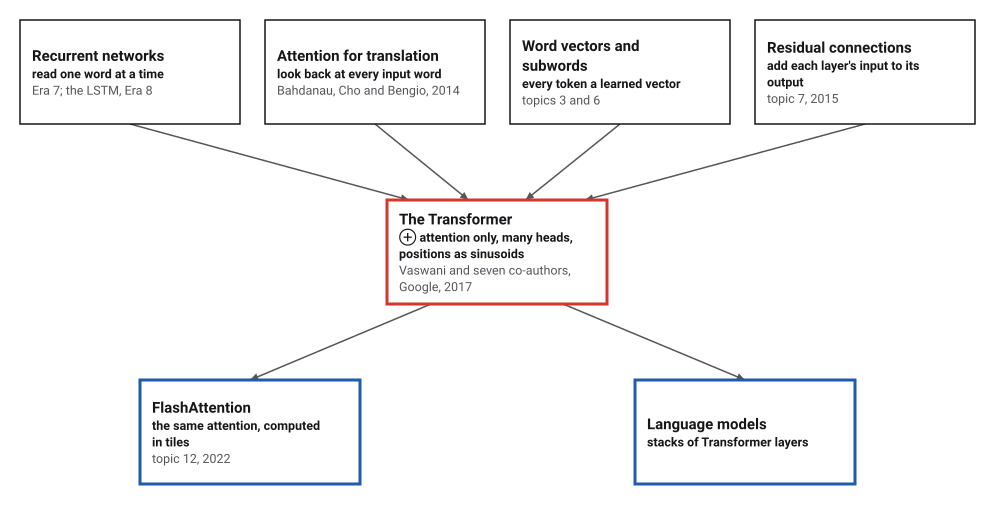
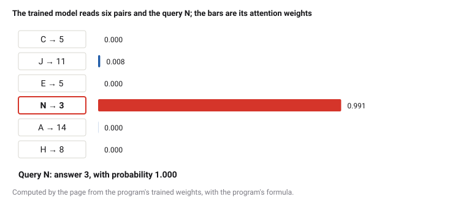
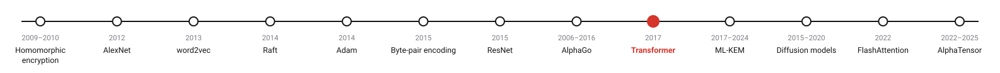
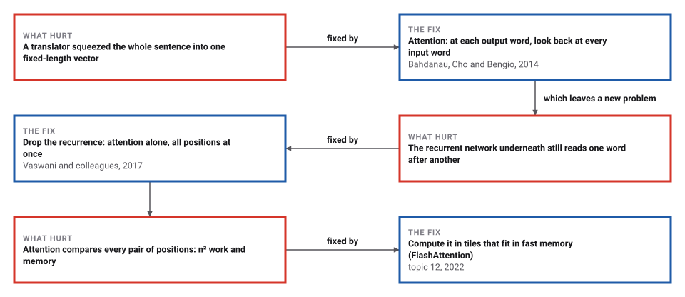
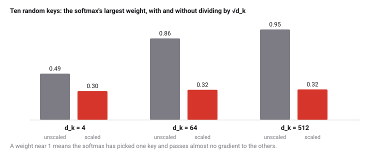

# The Transformer

*Era 9 · topic 9 · 2017* · [Era 9 index](../README.md) · [← Monte Carlo Tree Search and AlphaGo](../08-monte-carlo-tree-search/README.md) · [Lattice Cryptography and ML-KEM →](../10-lattice-cryptography/README.md) · [Interactive edition](transformer.html) · [Program](../../../code/era-09-learning-at-scale/09-transformer/)

> **Field note from the visiting historian.** I gave a single attention head sequences of keys and values and asked it, again and again, for the value under one key. It learned to put 98% of its attention on the right pair, and answered 100.0% of new questions correctly. The same model made to average instead of attend managed 29.4%.

| | |
|---|---|
| **When** | September 2014; June 2017 |
| **Where** | Montréal and Bremen; Google Brain, Google Research, Toronto |
| **What hurt** | One fixed vector, read one word at a time |
| **The fix** | softmax(QKᵀ/√d_k)V, many heads, no recurrence |
| **Checked** | 100.0% of lookups right, against 29.4% by averaging |

## How ideas combined

A new algorithm is usually an older idea combined with a new one. Recurrent networks read a sentence word by word. In 2014 Bahdanau, Cho and Bengio let a translator look back at all the input words through attention. In 2017 eight researchers at Google kept the attention and threw away the recurrence, added several attention heads side by side, encoded word positions as sinusoids, and wrapped every layer in a residual connection (topic 7).

<picture>
  <source media="(prefers-color-scheme: dark)" srcset="assets/family-dark.svg">
  
</picture>
*Red: the Transformer. Blue: what came after in this era.*

## A trained attention head

This is the program's trained model, running in your browser: one attention head that has learned to answer "what value is stored under this key?". Change the pairs or the query and watch where it attends. Then give it something it never saw in training: a query that matches no key, or two equal keys.

<picture>
  <source media="(prefers-color-scheme: dark)" srcset="assets/attn-dark.svg">
  
</picture>
*In the interactive edition the trained model runs in your browser on any sequence you choose.*

## Era 9, learning at scale

<picture>
  <source media="(prefers-color-scheme: dark)" srcset="assets/era-timeline-dark.svg">
  
</picture>

## Each fix leaves a new pain

<picture>
  <source media="(prefers-color-scheme: dark)" srcset="assets/chain-dark.svg">
  
</picture>
*Read it as a snake: each new problem sits directly under the fix that exposed it.*

## Queries, keys and values

**Three projections.** Every position's vector x is multiplied by three learned matrices to give a query q, a key k and a value v. The query says what this position is looking for; the key says what each position offers; the value is what it hands over.

**Scaled dot-product attention.** For one query, score every position by q · kᵢ / √d_k, turn the scores into weights with a softmax, and take the weighted sum of the values. For all positions at once this is softmax(QKᵀ/√d_k)V: two matrix products and a softmax, with no position waiting for another.

**Why √d_k.** If q and k have d_k independent parts of size about 1, their dot product has variance d_k. Without the division, long vectors give large scores, the softmax puts nearly all its weight on one position, and the gradient through it nearly vanishes.

**Heads, positions, layers.** The paper runs 8 heads side by side, each with its own projections of size d_k = 64 from d_model = 512, and joins their outputs. Attention by itself ignores order, so each position's vector gets a positional encoding made of sinusoids of different wavelengths. Each layer adds a small feed-forward network, and residual connections around both.

> **Key idea.** Let every position look at every other position directly, with weights it computes from the content. Distance in the sentence no longer matters, and the whole sequence is processed at once.

## A lookup, learned

**The task.** A sequence of 6 (key, value) pairs, keys from 16 letters and values from 16 numbers, then a query key; the answer is the value stored under it. The model is one attention head: d_model = 32, d_k = 16, a residual connection and an output layer, 3,584 parameters. Its gradients are written out by hand and agree with finite differences to 1.7 × 10⁻⁶. Training: Adam (topic 5), rate 0.003, 3,000 steps of 32 random sequences.

| Model | Right, on 5,000 new sequences |
|---|---|
| **one attention head** | **100.0%** |
| the same model, averaging all positions equally | 29.4% |
| a random value | 6.3% |

The trained head puts on average **0.978** of its attention on the pair whose key matches the query. Averaging cannot pick out one pair; it mixes all six values, and can do little better than guess among them.

**The scaling.** Ten random keys, query and keys with independent parts of variance 1, 2,000 trials: the variance of q · k, the largest softmax weight, and the softmax's slope (Σ aⱼ(1 − aⱼ), zero when one weight is 1):

| d_k | Variance of q·k | Largest weight, unscaled | scaled | Slope, unscaled | scaled |
|---|---|---|---|---|---|
| 4 | 4 | 0.488 | 0.305 | 0.647 | 0.810 |
| 64 | 65 | 0.859 | 0.318 | 0.199 | 0.807 |
| **512** | **505** | **0.953** | **0.322** | **0.068** | **0.804** |

<picture>
  <source media="(prefers-color-scheme: dark)" srcset="assets/scaling-dark.svg">
  
</picture>

**Positions.** With the paper's sinusoids (d = 64), the dot product of the encodings of positions p and p + k is the same for every p: 0 apart 32.000, 1 apart 30.917, 2 apart 28.304, 5 apart 23.504, 10 apart 21.052, 50 apart 15.674 (largest difference 2.5 × 10⁻¹⁴). Position becomes something a dot product, and so attention, can measure.

**The cost.** Attention compares every pair of positions, n² · d work per layer, but all of it can run at once; a recurrent layer does d² work per position, n steps one after another:

| Positions n | d | Attention multiply-adds | Recurrent multiply-adds | Steps in sequence |
|---|---|---|---|---|
| 50 | 512 | 2,560,000 | 13,107,200 | 50 |
| 512 | 512 | 268,435,456 | 134,217,728 | 512 |
| 4,096 | 512 | 17,179,869,184 | 1,073,741,824 | 4,096 |

For short sequences attention is cheaper as well as parallel; for long ones its n² grows past the recurrent cost, which is the pain FlashAttention (topic 12) works on.

## Montréal 2014, Google 2017

Bahdanau (Jacobs University Bremen), Cho and Bengio (Université de Montréal), ICLR 2015: "the use of a fixed-length vector is a bottleneck in improving the performance"; the fix is "allowing a model to automatically (soft-)search for parts of a source sentence that are relevant to predicting a target word".

Vaswani, Shazeer, Parmar, Uszkoreit, Jones, Gomez, Kaiser and Polosukhin (Google Brain, Google Research, University of Toronto; "Equal contribution. Listing order is random."), submitted 12 June 2017: a model "based solely on attention mechanisms, dispensing with recurrence and convolutions entirely"; "Attention(Q, K, V) = softmax(QKᵀ/√dk)V"; the scaling because large dot products push the softmax "into regions where it has extremely small gradients"; "h = 8 parallel attention layers, or heads"; "each dimension of the positional encoding corresponds to a sinusoid"; 28.4 BLEU on WMT 2014 English-to-German, and 41.8 on English-to-French "after training for 3.5 days on eight GPUs".

## A lookup table that learns

A hash table (Era 5) finds a value by its exact key. Attention is a soft version: every key is compared with the query, and the values are blended by how well they match. The model here learned to behave like a lookup table, with nothing but a softmax over dot products.

> **Full circle.** One attention head, 3,584 parameters, 100.0% right on lookups it had never seen, against 29.4% when it may only average.

## Before you read on

<details>
<summary><b>1.</b> Scores 2, 1 and 0 go into a softmax. What are the weights?</summary>

e², e¹, e⁰ divided by their sum: about 0.665, 0.245 and 0.090.
</details>

<details>
<summary><b>2.</b> With d_k = 64, by what number are the scores divided, and why?</summary>

By 8 = √64, so that their spread stays about 1 however long the vectors are.
</details>

<details>
<summary><b>3.</b> Why does attention need a positional encoding?</summary>

The weighted sum treats the positions as a set; shuffling them would give the same output without it.
</details>

<details>
<summary><b>4.</b> How many query-key scores does one head compute for 1,000 positions?</summary>

1,000 × 1,000 = 1,000,000.
</details>

<details>
<summary><b>5.</b> A recurrent network needs n steps one after another. How many does an attention layer need?</summary>

One: every position's output depends only on the layer's inputs, so all can be computed at once.
</details>


## Where the evidence lives

| | Object | Where to see it | Licence |
|---|---|---|---|
| — | **Attention Is All You Need (2017)**. Vaswani and seven co-authors, arXiv:1706.03762. | [arXiv:1706.03762](https://arxiv.org/abs/1706.03762v3) | Drawn placeholder. |

## Every link was opened before it was listed

| Level | Link | Why |
|---|---|---|
| Start | [Attention in transformers, step-by-step \| Deep Learning Chapter 6](https://www.youtube.com/watch?v=eMlx5fFNoYc) — 3Blue1Brown | Queries, keys and values, drawn |
| Deeper | [Let's build GPT: from scratch, in code, spelled out.](https://www.youtube.com/watch?v=kCc8FmEb1nY) — Andrej Karpathy | A small transformer written and trained live |
| Scholar | [Attention Is All You Need](https://arxiv.org/pdf/1706.03762) — A. Vaswani and seven co-authors (2017) | The Transformer |
| Scholar | [Neural Machine Translation by Jointly Learning to Align and Translate](https://arxiv.org/pdf/1409.0473) — D. Bahdanau, K. Cho, Y. Bengio (2014; ICLR 2015) | Attention, before the Transformer |

More, with certainty labels and the gaps we could not fill: [Era 9 reference catalog](https://github.com/vij658/AlgorithmEvolutionAtlas/blob/main/book/era-09-learning-at-scale/reference-catalog.md).

## The program behind every number here

[Transformer.java](https://github.com/vij658/AlgorithmEvolutionAtlas/blob/main/code/era-09-learning-at-scale/09-transformer/Transformer.java) makes **6 checks**: the hand-written gradients, that attention learns the lookup and averaging cannot, the softmax saturating without √d_k, the sinusoids' dot products, and that the rounded weights shown to the widget behave the same. Run it with `java Transformer.java` (JDK 17 or newer). The heart of it:

```java
/** Forward and, when g is not null, backward. Returns the loss; probs and attention are filled when not null. */
static double run(Model m, Example e, Model g, double[] probsOut, double[] attnOut) {
    double[][] x = new double[PAIRS][D];
    for (int i = 0; i < PAIRS; i++) for (int t = 0; t < D; t++) x[i][t] = m.Ek[e.keys[i]][t] + m.Ev[e.vals[i]][t];
    double[] xq = m.Ek[e.query].clone();
    double[] q = mul(m.Wq, xq);
    double[][] k = new double[PAIRS][], v = new double[PAIRS][];
    double[] s = new double[PAIRS], a = new double[PAIRS];
    double mx = -1e300;
    for (int i = 0; i < PAIRS; i++) {
        k[i] = mul(m.Wk, x[i]); v[i] = mul(m.Wv, x[i]);
        double dot = 0; for (int t = 0; t < DK; t++) dot += q[t] * k[i][t];
        s[i] = dot / Math.sqrt(DK);
        mx = Math.max(mx, s[i]);
    }
    double z = 0;
    for (int i = 0; i < PAIRS; i++) { a[i] = m.attend ? Math.exp(s[i] - mx) : 1; z += a[i]; }
    for (int i = 0; i < PAIRS; i++) a[i] /= z;
    if (attnOut != null) System.arraycopy(a, 0, attnOut, 0, PAIRS);
    double[] o = new double[D];
    for (int i = 0; i < PAIRS; i++) for (int t = 0; t < D; t++) o[t] += a[i] * v[i][t];
    double[] h = new double[D];
    for (int t = 0; t < D; t++) h[t] = o[t] + xq[t]; // residual connection
    double[] logit = mul(m.Wo, h);
    double lm = Arrays.stream(logit).max().getAsDouble(), lz = 0;
    double[] p = new double[NV];
    for (int c = 0; c < NV; c++) { p[c] = Math.exp(logit[c] - lm); lz += p[c]; }
    for (int c = 0; c < NV; c++) p[c] /= lz;
    if (probsOut != null) System.arraycopy(p, 0, probsOut, 0, NV);
    double loss = -Math.log(p[e.answer]);
    if (g == null) return loss;
    // ---- backward ----
    double[] dl = p.clone(); dl[e.answer] -= 1;
    double[] dh = new double[D];
    for (int c = 0; c < NV; c++) for (int t = 0; t < D; t++) { g.Wo[c][t] += dl[c] * h[t]; dh[t] += m.Wo[c][t] * dl[c]; }
    double[] dxq = dh.clone(), dq = new double[DK];
    double[] da = new double[PAIRS];
    double[][] dx = new double[PAIRS][D];
    for (int i = 0; i < PAIRS; i++) {
        for (int t = 0; t < D; t++) da[i] += dh[t] * v[i][t];
        // through v_i = Wv x_i, with dv_i = a_i dh
        for (int r = 0; r < D; r++) {
            double dvr = a[i] * dh[r];
            for (int t = 0; t < D; t++) { g.Wv[r][t] += dvr * x[i][t]; dx[i][t] += m.Wv[r][t] * dvr; }
        }
    }
    if (m.attend) {
        double sum = 0; for (int i = 0; i < PAIRS; i++) sum += a[i] * da[i];
        for (int i = 0; i < PAIRS; i++) {
            double ds = a[i] * (da[i] - sum) / Math.sqrt(DK);
            for (int t = 0; t < DK; t++) dq[t] += ds * k[i][t];
            for (int r = 0; r < DK; r++) {
                double dkr = ds * q[r];
                for (int t = 0; t < D; t++) { g.Wk[r][t] += dkr * x[i][t]; dx[i][t] += m.Wk[r][t] * dkr; }
            }
        }
        for (int r = 0; r < DK; r++) for (int t = 0; t < D; t++) { g.Wq[r][t] += dq[r] * xq[t]; dxq[t] += m.Wq[r][t] * dq[r]; }
    }
    for (int i = 0; i < PAIRS; i++) for (int t = 0; t < D; t++) { g.Ek[e.keys[i]][t] += dx[i][t]; g.Ev[e.vals[i]][t] += dx[i][t]; }
    for (int t = 0; t < D; t++) g.Ek[e.query][t] += dxq[t];
    return loss;
}
```

