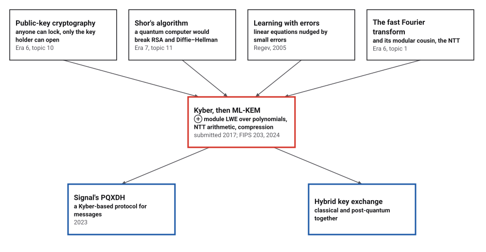
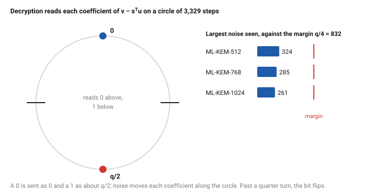
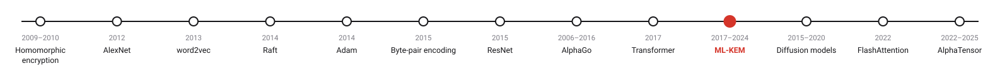
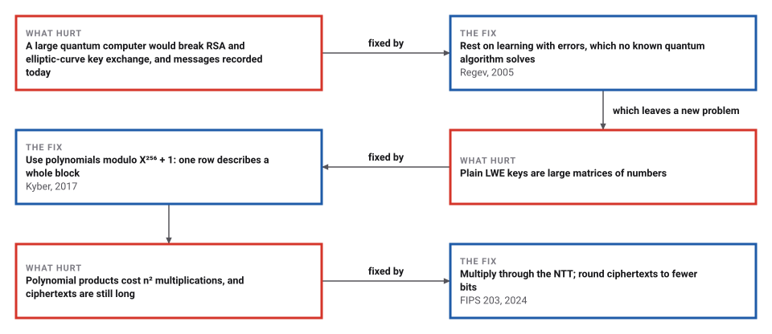

# Lattice Cryptography and ML-KEM

*Era 9 · topic 10 · 2017–2024* · [Era 9 index](../README.md) · [← The Transformer](../09-transformer/README.md) · [Diffusion Models →](../11-diffusion-models/README.md) · [Interactive edition](lattice-cryptography.html) · [Program](../../../code/era-09-learning-at-scale/10-lattice-cryptography/)

> **Field note from the visiting historian.** I gave the program sixteen equations and asked for the secret behind them. It found it 200 times out of 200. Then I nudged every equation by at most two, and it found it 0 times. The receiver of an ML-KEM message carries a little of that noise too, but knows the secret, and rounds it away.

| | |
|---|---|
| **When** | Regev 2005; Kyber 2017; FIPS 203, August 2024 |
| **Where** | The CRYSTALS-Kyber team; NIST |
| **What hurt** | Quantum computers would break RSA and Diffie–Hellman |
| **The fix** | Module learning with errors, NTT arithmetic, compression |
| **Checked** | Sizes of all three sets; every test message decrypted |

## How ideas combined

A new algorithm is usually an older idea combined with a new one. Public-key cryptography (Era 6) rests on factoring and discrete logarithms, both of which Shor's algorithm (Era 7) would solve on a large quantum computer. In 2005 Oded Regev described a different hard problem, learning with errors. Kyber built a key exchange on it from polynomials, multiplied fast with the number-theoretic transform, the fast Fourier transform's modular cousin; in August 2024 NIST standardized it as ML-KEM.

<picture>
  <source media="(prefers-color-scheme: dark)" srcset="assets/family-dark.svg">
  
</picture>
*Red: Kyber and ML-KEM. Blue: where it went next.*

## Noise, and the margin

Your browser runs the scheme's arithmetic: a key pair, then one encryption and decryption of 256 random bits. Each decrypted coefficient is drawn on a circle of 3,329 steps: 0 bits should land near the top, 1 bits near the bottom. Make the errors larger, or keep fewer bits of the ciphertext, and watch the dots spread until some cross the line.

<picture>
  <source media="(prefers-color-scheme: dark)" srcset="assets/circle-dark.svg">
  
</picture>
*In the interactive edition you can change the parameters and encrypt messages yourself.*

## Era 9, learning at scale

<picture>
  <source media="(prefers-color-scheme: dark)" srcset="assets/era-timeline-dark.svg">
  
</picture>

## Each fix leaves a new pain

<picture>
  <source media="(prefers-color-scheme: dark)" srcset="assets/chain-dark.svg">
  
</picture>
*Read it as a snake: each new problem sits directly under the fix that exposed it.*

## Equations with errors

**Learning with errors.** Pick a random matrix A and a secret vector s with small entries, and publish A and b = As + e (mod q), where e is a vector of small random errors. Without e, Gaussian elimination recovers s at once. With e, nobody knows an efficient way, on an ordinary or a quantum computer.

**Polynomials.** ML-KEM's numbers are polynomials of degree below 256 with coefficients modulo q = 3,329, multiplied modulo X²⁵⁶ + 1; A is a k × k matrix of them, s and e vectors of k. Small means coefficients from a centred binomial distribution: η coin flips minus η more.

**Keys and encryption.** The public key is A (sent as a seed) and t = As + e. To send 256 bits m, pick small r, e₁ and e₂ and send u = Aᵀr + e₁ and v = tᵀr + e₂ + ⌈q/2⌋·m, each rounded to d_u and d_v bits. The receiver computes v − sᵀu = eᵀr + e₂ − sᵀe₁ + rounding + ⌈q/2⌋·m. Everything but the last term is small, so each coefficient is near 0 for a 0 bit and near q/2 for a 1.

**The NTT.** Because 17 is a primitive 256th root of unity modulo 3,329, a polynomial can be transformed so that multiplication becomes 128 small products of pairs. ML-KEM wraps this encryption scheme (K-PKE) with hashing to make a key-encapsulation mechanism: a shared secret key that two parties can agree on.

> **Key idea.** Hide the secret under noise small enough for the key holder to round away and large enough that no one else can solve the equations.

## Three parameter sets

**With and without errors.** 16 equations in 16 unknowns modulo 3329, 200 random trials. Without errors, Gaussian elimination recovered the secret **200** times. With errors from −2 to 2 added: **0** times; on average 16.0 of the 16 entries came out wrong. A tiny error ruins the method completely.

**The NTT.** 17¹²⁸ = 3328 = −1 modulo 3,329, so 17 is a primitive 256th root of unity. On 50 random pairs of polynomials, multiplying through the NTT gave exactly the schoolbook product modulo X²⁵⁶ + 1, with about 3,584 multiplications instead of 65,536.

**The parameter sets.** The program computes key and ciphertext sizes from the formulas (public key 384k + 32 bytes, ciphertext 32(d_u·k + d_v), secret key 768k + 96) and compares them with the published sizes, in brackets; then it encrypts 1,000 random 256-bit messages under 20 keys for each set:

| Set | k | η₁ | d_u, d_v | Public key | Ciphertext | Secret key | Wrong bits | Largest noise |
|---|---|---|---|---|---|---|---|---|
| ML-KEM-512 | 2 | 3 | 10, 4 | 800 (800) | 768 (768) | 1,632 (1,632) | 0 in 1,000 | 324 |
| ML-KEM-768 | 3 | 2 | 10, 4 | 1,184 (1,184) | 1,088 (1,088) | 2,400 (2,400) | 0 in 1,000 | 285 |
| ML-KEM-1024 | 4 | 2 | 11, 5 | 1,568 (1,568) | 1,568 (1,568) | 3,168 (3,168) | 0 in 1,000 | 261 |

A bit is read wrongly only when the noise passes q/4 = 832. The largest noise seen in 256,000 coefficients per set stayed well under half of that. FIPS 203 puts the probability that a decapsulation fails at 2⁻¹³⁸·⁸, 2⁻¹⁶⁴·⁸ and 2⁻¹⁷⁴·⁸ for the three sets.

**Too much noise.** k = 3 and 100 messages each, with larger errors or harsher rounding:

| Variant | Wrong bits | Out of | Largest noise |
|---|---|---|---|
| **ML-KEM-768 as published** | **0** | **25,600** | **255** |
| eta1 = eta2 = 6 | 0 | 25,600 | 561 |
| eta1 = eta2 = 10 | 3 | 25,600 | 935 |
| du = 6, dv = 2 | 2178 | 25,600 | 1661 |
| du = 5, dv = 2 | 8604 | 25,600 | 1664 |

The parameters are a balance: more noise makes the equations harder to solve, until it makes decryption fail.

## NIST, August 2024

NIST, FIPS 203, "Published August 13, 2024": "ML-KEM is derived from the round-three version of the CRYSTALS-KYBER KEM"; "The security of ML-KEM is related to the computational difficulty of the Module Learning with Errors problem"; q is "the prime integer 3329"; "𝜁 = 17 ∈ ℤ𝑞 is a primitive 256-th root of unity modulo 𝑞"; decapsulation failure probabilities 2⁻¹³⁸·⁸, 2⁻¹⁶⁴·⁸ and 2⁻¹⁷⁴·⁸.

Wikipedia: Kyber was submitted to NIST in 2017 and was "the first key encapsulation mechanism that has been selected for standardization"; it is "based on the module learning with errors (M-LWE) problem, in conjunction with cyclotomic rings", "derived from a method published in 2005 by Oded Regev"; Signal adopted the Kyber-based PQXDH protocol in 2023. The parameter sets' sizes are from the chapter on ML-KEM in *Elements of Cryptanalysis* and agree with Wikipedia's for ML-KEM-768.

## Two thousand years of linear equations

The Nine Chapters' fangcheng (Era 2) solved systems of linear equations by elimination on a counting board. ML-KEM's security rests on the same equations, made unsolvable by a little noise in each. The fast Fourier transform (Era 6), in its modular form, makes the arithmetic quick.

> **Full circle.** Gaussian elimination solved 200 of 200 systems exactly. Add errors of at most 2 to each equation, and it solved 0.

## Before you read on

<details>
<summary><b>1.</b> What is the ML-KEM-768 public key size from 384k + 32 with k = 3?</summary>

384 × 3 + 32 = 1,184 bytes.
</details>

<details>
<summary><b>2.</b> Why does a bit flip only when the noise passes q/4?</summary>

0 is sent as 0 and 1 as about q/2; the receiver picks the nearer of the two, and they are q/2 apart, so a coefficient is read wrongly only if it moves more than q/4.
</details>

<details>
<summary><b>3.</b> With η = 2, what values can one coefficient of a small polynomial take?</summary>

−2 to 2: two coin flips minus two coin flips.
</details>

<details>
<summary><b>4.</b> Why does rounding u and v to fewer bits not break decryption?</summary>

Rounding adds at most half a step of the coarser scale, a little extra noise that stays inside the margin for the published parameters.
</details>

<details>
<summary><b>5.</b> Why would an attacker record encrypted traffic today?</summary>

To decrypt it later, if a large quantum computer is ever built; this is why the replacement started before such a computer exists.
</details>


## Where the evidence lives

| | Object | Where to see it | Licence |
|---|---|---|---|
| — | **FIPS 203: Module-Lattice-Based Key-Encapsulation Mechanism Standard (2024)**. NIST. | [FIPS 203 (PDF)](https://nvlpubs.nist.gov/nistpubs/fips/nist.fips.203.pdf) | Drawn placeholder. |

## Every link was opened before it was listed

| Level | Link | Why |
|---|---|---|
| Start | [Learning with errors: Encrypting with unsolvable equations](https://www.youtube.com/watch?v=K026C5YaB3A) — Chalk Talk | Equations with errors, and why they hide a secret |
| Start | [ML-KEM](https://en.wikipedia.org/wiki/ML-KEM) — Wikipedia | From Regev to the standard |
| Deeper | [Learning With Errors (LWE) and Public Key Encryption \|\| @ CMU \|\| Lecture 25d of CS Theory Toolkit](https://www.youtube.com/watch?v=QcVns57MTxg) — Ryan O'Donnell | Regev's public-key scheme, in a Carnegie Mellon course |
| Deeper | [ML-KEM (Kyber) – Design and Implementation](https://bnaskrecki.faculty.wmi.amu.edu.pl/crypto/book/part14_lattice_crypto/ch41_ml_kem_kyber.html) — *Elements of Cryptanalysis*, chapter 41 | The parameter sets, worked through |
| Scholar | [FIPS 203: Module-Lattice-Based Key-Encapsulation Mechanism Standard](https://nvlpubs.nist.gov/nistpubs/fips/nist.fips.203.pdf) — NIST (13 August 2024) | The standard |

More, with certainty labels and the gaps we could not fill: [Era 9 reference catalog](https://github.com/vij658/AlgorithmEvolutionAtlas/blob/main/book/era-09-learning-at-scale/reference-catalog.md).

## The program behind every number here

[LatticeKem.java](https://github.com/vij658/AlgorithmEvolutionAtlas/blob/main/code/era-09-learning-at-scale/10-lattice-cryptography/LatticeKem.java) makes **11 checks**: Gaussian elimination with and without errors, the NTT against schoolbook multiplication, every message of every parameter set, the sizes against the published ones, and decryption failing when the noise is too large. Run it with `java LatticeKem.java` (JDK 17 or newer). The heart of it:

```java
// ---- the number-theoretic transform (FIPS 203, Algorithms 9 to 12) --------------------------------------------------
static int[] ntt(int[] a) {
    int[] f = a.clone();
    int i = 1;
    for (int len = 128; len >= 2; len /= 2)
        for (int start = 0; start < N; start += 2 * len) {
            int z = pow(ZETA, bitrev7(i++));
            for (int j = start; j < start + len; j++) {
                int t = mod((long) z * f[j + len]);
                f[j + len] = mod(f[j] - t);
                f[j] = mod(f[j] + t);
            }
        }
    return f;
}

/** Encrypts and decrypts one message; returns the number of wrong bits and stores the largest noise in noise[0]. */
static int roundTripMessage(Params P, Keys K, Random r, int[] noise, int du, int dv) {
    int[] m = new int[N];
    for (int i = 0; i < N; i++) m[i] = r.nextInt(2);
    int[][] rhat = new int[P.k][];
    for (int i = 0; i < P.k; i++) rhat[i] = ntt(cbd(P.eta1, r));
    int[][] u = new int[P.k][];
    for (int i = 0; i < P.k; i++) {
        int[] acc = new int[N];
        for (int j = 0; j < P.k; j++) acc = add(acc, mulNtt(K.Ahat[j][i], rhat[j])); // A transposed
        u[i] = roundTrip(add(invNtt(acc), cbd(P.eta2, r)), du);
    }
    int[] acc = new int[N];
    for (int j = 0; j < P.k; j++) acc = add(acc, mulNtt(K.that[j], rhat[j]));
    int[] mu = new int[N];
    for (int i = 0; i < N; i++) mu[i] = m[i] * ((Q + 1) / 2);
    int[] v = roundTrip(add(add(invNtt(acc), cbd(P.eta2, r)), mu), dv);
    // decryption
    int[] su = new int[N];
    for (int j = 0; j < P.k; j++) su = add(su, mulNtt(K.shat[j], ntt(u[j])));
    int[] w = sub(v, invNtt(su));
    int wrong = 0;
    for (int i = 0; i < N; i++) {
        int bit = compress(w[i], 1);
        if (bit != m[i]) wrong++;
        noise[0] = Math.max(noise[0], Math.abs(centre(mod(w[i] - mu[i]))));
    }
    return wrong;
}
```

