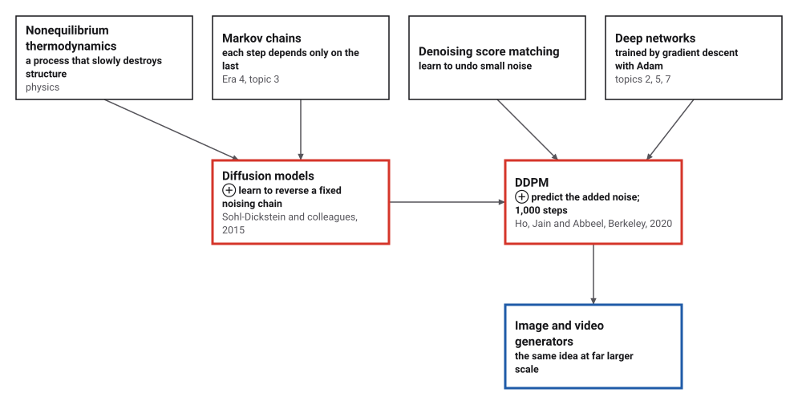
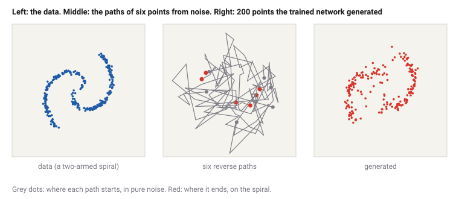
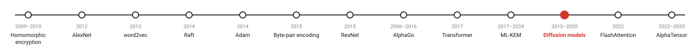
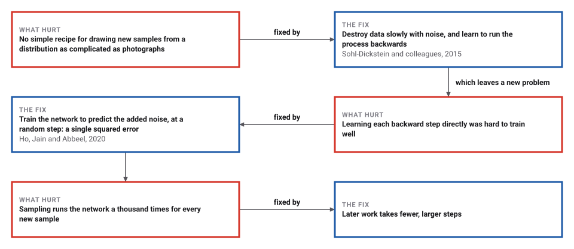

# Diffusion Models

*Era 9 · topic 11 · 2015–2020* · [Era 9 index](../README.md) · [← Lattice Cryptography and ML-KEM](../10-lattice-cryptography/README.md) · [FlashAttention →](../12-flashattention/README.md) · [Interactive edition](diffusion-models.html) · [Program](../../../code/era-09-learning-at-scale/11-diffusion-models/)

> **Field note from the visiting historian.** I drew a spiral of points and buried it under a thousand thin layers of noise until nothing was left. Then I taught a small network one skill, guessing the noise in a noisy point. Starting from pure static, it removed its guesses step by step, and new points gathered on both arms of the spiral, 0.0464 from it on average.

| | |
|---|---|
| **When** | March 2015; June 2020 |
| **Where** | Sohl-Dickstein and colleagues; UC Berkeley |
| **What hurt** | No simple recipe for sampling complicated distributions |
| **The fix** | Learn to reverse a fixed noising chain, by guessing the noise |
| **Checked** | Generated points 0.0464 from the spiral; noise 0.4123 |

## How ideas combined

A new algorithm is usually an older idea combined with a new one. In 2015 Sohl-Dickstein, Weiss, Maheswaranathan and Ganguli took an idea from the physics of systems out of equilibrium: destroy the structure in data slowly, with a Markov chain (Era 4) of small noise steps, then learn the reverse chain. In 2020 Ho, Jain and Abbeel at Berkeley reduced the learning to one instruction, guess the noise, and the samples became excellent.

<picture>
  <source media="(prefers-color-scheme: dark)" srcset="assets/family-dark.svg">
  
</picture>
*Red: the two diffusion papers. Blue: what came after.*

## Noise one way, pictures the other

The data is a two-armed spiral of points. Drag the slider to run the forward process: the formula is fixed, nothing is learned. Then press *Generate from noise*: your browser starts from 200 points of pure noise and runs 1,000 reverse steps with the program's trained network.

<picture>
  <source media="(prefers-color-scheme: dark)" srcset="assets/panels-dark.svg">
  
</picture>
*In the interactive edition you can noise the data and generate new points yourself.*

## Era 9, learning at scale

<picture>
  <source media="(prefers-color-scheme: dark)" srcset="assets/era-timeline-dark.svg">
  
</picture>

## Each fix leaves a new pain

<picture>
  <source media="(prefers-color-scheme: dark)" srcset="assets/chain-dark.svg">
  
</picture>
*Read it as a snake: each new problem sits directly under the fix that exposed it. The last fix is described generally; no source for it was opened.*

## Learn to guess the noise

**Forward.** For t = 1 to T = 1,000, xₜ = √(1 − βₜ) xₜ₋₁ + √βₜ · noise, with βₜ rising linearly from 0.0001 to 0.02. Every step is a little Gaussian blur of the data's distribution. Writing αₜ = 1 − βₜ and ᾱₜ for their product up to t, any step can be reached in one jump: xₜ = √ᾱₜ x₀ + √(1 − ᾱₜ) ε with ε standard Gaussian noise.

**Training.** Take a data point x₀, a step t chosen uniformly from 1 to 1,000 and fresh noise ε; form xₜ in one jump; ask the network ε_θ(xₜ, t) for its guess of ε, and take a gradient step on the squared error. The network is told t through sines and cosines of several frequencies.

**Sampling.** Start from pure noise x_T. For t = T down to 1: xₜ₋₁ = (xₜ − βₜ/√(1 − ᾱₜ) · ε_θ(xₜ, t)) / √αₜ + √βₜ · z, with fresh Gaussian z, except at the last step. The guessed noise is removed a little at a time; the added z keeps the result random, so every run gives new samples.

> **Key idea.** Destroying data is easy and needs no learning. Learn only the small step that undoes a little of it, and repeat that step a thousand times.

## A spiral from static

**The forward process** on 4,000 spiral points, run as 1,000 separate small steps, against the one-jump formula: the leftover noise xₜ − √ᾱₜ x₀ should have variance 1 − ᾱₜ.

| Step t | ᾱₜ | Variance, step by step | Closed form 1 − ᾱₜ | Spread of x |
|---|---|---|---|---|
| 100 | 0.89702 | 0.103 | 0.103 | 0.918 |
| 300 | 0.39642 | 0.629 | 0.604 | 0.963 |
| 1000 | 0.00004 | 1.016 | 1.000 | 1.021 |

After 1,000 steps √ᾱ_T = 0.0064 of each point is left: the spiral is gone, and the points have the spread of plain Gaussian noise.

**Training.** The network takes the point and 16 sines and cosines of t, has two hidden layers of 64, and has 5,506 parameters; its hand-written gradients agree with finite differences to 2.4 × 10⁻⁸. Trained with Adam for 12,000 steps of 64 noisy points. The mean squared error of its noise guess (a guess of zero scores 2.0) fell from 0.523 after the first 1,000 steps to 0.398; much of the noise at large t cannot be guessed at all, so it never approaches zero.

**Sampling.** 600 new points, each from pure noise through 1,000 reverse steps. The mean distance from each point to the nearest of 3,000 spiral points:

| Points | Mean distance to the spiral |
|---|---|
| fresh points from the spiral itself | 0.0111 |
| **generated by the reverse process** | **0.0464** |
| Gaussian noise | 0.4123 |
| the reverse process with the network replaced by 0 | 276.4346 |

The generated points sit close to the spiral, not as tightly as real points, and 298 landed on one arm and 302 on the other. Without the trained network the reverse steps only divide by √αₜ again and again, and the points fly apart.

## 2015, and Berkeley in 2020

Sohl-Dickstein, Weiss, Maheswaranathan and Ganguli (submitted 12 March 2015): the idea "is to systematically and slowly destroy structure in a data distribution through an iterative forward diffusion process", then to "learn a reverse diffusion process that restores structure in data".

Ho, Jain and Abbeel (UC Berkeley, 2020): the forward process "is fixed to a Markov chain that gradually adds Gaussian noise to the data according to a variance schedule" and "admits sampling xt at an arbitrary timestep t in closed form"; "We set T = 1000 for all experiments", with β rising linearly from 10⁻⁴ to 0.02; the training objective is the squared error of the predicted noise with "t is uniform between 1 and T"; sampling runs "for t = T, . . . , 1" with fresh noise "if t > 1, else z = 0". On CIFAR10: "an Inception score of 9.46 and a state-of-the-art FID score of 3.17". Their parameterization "reveals an equivalence with denoising score matching over multiple noise levels".

## Markov's chains, run backwards

Markov (Era 4) studied chains in which each step depends only on the one before. A diffusion model is such a chain, run forwards to turn data into noise, and then, with a learned network, run backwards to turn noise into data. The Monte Carlo method (Era 4) supplies the randomness at every step.

> **Full circle.** Plain noise lies 0.4123 from the spiral on average. After 1,000 learned steps, the same kind of noise lies 0.0464 from it.

## Before you read on

<details>
<summary><b>1.</b> ᾱₜ = 0.25. What are the weights of x₀ and of the noise in xₜ?</summary>

√0.25 = 0.5 for x₀ and √0.75 ≈ 0.866 for the noise.
</details>

<details>
<summary><b>2.</b> Why can training pick any t at random without running the earlier steps?</summary>

Because xₜ has a closed form in x₀ and one draw of noise.
</details>

<details>
<summary><b>3.</b> Why add fresh noise z during sampling, rather than only subtract?</summary>

Each reverse step is itself a random step; without z every run from the same start would give the same point, and the samples lose their variety.
</details>

<details>
<summary><b>4.</b> Why does the noise-guessing error stay well above zero?</summary>

At large t the data contributes almost nothing to xₜ, so the noise cannot be told from the data's own position; only an average guess is possible.
</details>

<details>
<summary><b>5.</b> How many network evaluations does one sample need here?</summary>

1,000, one per reverse step.
</details>


## Where the evidence lives

| | Object | Where to see it | Licence |
|---|---|---|---|
| — | **Denoising Diffusion Probabilistic Models (2020)**. Ho, Jain and Abbeel, arXiv:2006.11239. | [arXiv:2006.11239 (PDF)](https://arxiv.org/pdf/2006.11239v2) | Drawn placeholder. |

## Every link was opened before it was listed

| Level | Link | Why |
|---|---|---|
| Start | [But how do AI images and videos actually work? \| Guest video by Welch Labs](https://www.youtube.com/watch?v=iv-5mZ_9CPY) — 3Blue1Brown | Diffusion from the ground up, a guest video on 3Blue1Brown's channel |
| Deeper | [Diffusion Models \| Paper Explanation \| Math Explained](https://www.youtube.com/watch?v=HoKDTa5jHvg) — Outlier | The mathematics of the 2020 paper |
| Scholar | [Deep Unsupervised Learning using Nonequilibrium Thermodynamics](https://arxiv.org/abs/1503.03585v1) — J. Sohl-Dickstein, E. A. Weiss, N. Maheswaranathan, S. Ganguli (2015) | The idea |
| Scholar | [Denoising Diffusion Probabilistic Models](https://arxiv.org/pdf/2006.11239v2) — J. Ho, A. Jain, P. Abbeel (2020) | The simplified training and sampling |

More, with certainty labels and the gaps we could not fill: [Era 9 reference catalog](https://github.com/vij658/AlgorithmEvolutionAtlas/blob/main/book/era-09-learning-at-scale/reference-catalog.md).

## The program behind every number here

[Diffusion.java](https://github.com/vij658/AlgorithmEvolutionAtlas/blob/main/code/era-09-learning-at-scale/11-diffusion-models/Diffusion.java) makes **7 checks**: the forward process against its closed form, the hand-written gradients, that generated points lie near the spiral on both arms, and that the reverse process fails without the network. Run it with `java Diffusion.java` (JDK 17 or newer). The heart of it:

```java
static double[][] sample(Net n, int count, Random r, boolean zeroNet, List<double[][]> paths) {
    double[][] x = new double[count][2];
    for (double[] p : x) { p[0] = r.nextGaussian(); p[1] = r.nextGaussian(); }
    for (int t = T; t >= 1; t--) {
        for (int i = 0; i < count; i++) {
            double[] e = zeroNet ? new double[2] : forward(n, embed(x[i][0], x[i][1], t), null, null, null);
            for (int c = 0; c < 2; c++) {
                double mean = (x[i][c] - beta[t] / Math.sqrt(1 - abar[t]) * e[c]) / Math.sqrt(alpha[t]);
                x[i][c] = mean + (t > 1 ? Math.sqrt(beta[t]) * r.nextGaussian() : 0);
            }
            if (paths != null && i < paths.size() && (t - 1) % 50 == 0) paths.get(i)[(T - t + 1) / 50] = x[i].clone();
        }
    }
    return x;
}
```

