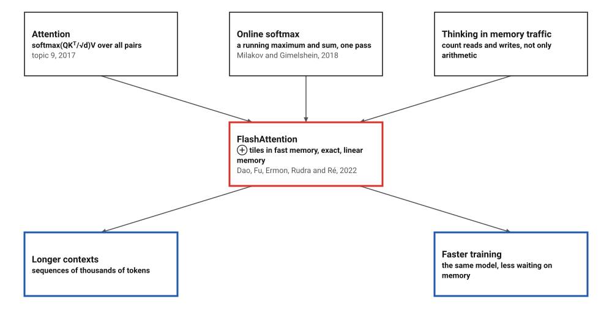
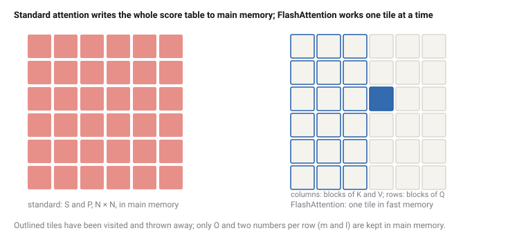
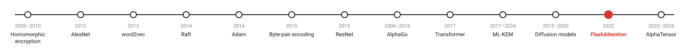
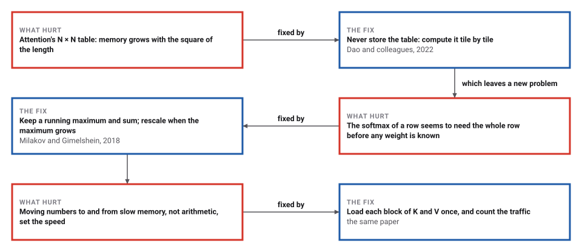

# FlashAttention

*Era 9 · topic 12 · 2022* · [Era 9 index](../README.md) · [← Diffusion Models](../11-diffusion-models/README.md) · [Algorithms That Find Algorithms →](../13-algorithms-that-find-algorithms/README.md) · [Interactive edition](flashattention.html) · [Program](../../../code/era-09-learning-at-scale/12-flashattention/)

> **Field note from the visiting historian.** I computed attention twice, once the standard way and once in tiles with a running maximum and sum. The answers matched to 6.4e-16. The tiled method moved 3.2 times fewer numbers through slow memory at N = 1,024, and at N = 65,536 it needed 131,072 numbers of extra memory instead of 8,589,934,592.

| | |
|---|---|
| **When** | 2018; May 2022 |
| **Where** | Stanford University; University at Buffalo |
| **What hurt** | An N × N table moved through slow memory |
| **The fix** | Tiles in fast memory, with a rescaled running softmax |
| **Checked** | Same output to 6.4 × 10⁻¹⁶; traffic 3.9× less at N = 65,536 |

## How ideas combined

A new algorithm is usually an older idea combined with a new one. The Transformer's attention (topic 9) compares every position with every other. In 2018 Milakov and Gimelshein showed how to compute a softmax in one pass, keeping a running maximum and sum. Dao, Fu, Ermon, Rudra and Ré combined that with a habit from the analysis of algorithms for slow memory: count the reads and writes. The result computes exactly the same attention with far less traffic.

<picture>
  <source media="(prefers-color-scheme: dark)" srcset="assets/family-dark.svg">
  
</picture>
*Red: FlashAttention. Blue: what it was for.*

## One tile at a time

The square is the table of attention scores, cut into tiles. Step through FlashAttention's loops: each tile is computed in fast memory and thrown away. Watch the first row's running maximum and sum, and the traffic to main memory, which standard attention spends on writing and reading the whole table.

<picture>
  <source media="(prefers-color-scheme: dark)" srcset="assets/tiles-dark.svg">
  
</picture>
*In the interactive edition you can step through the tiles and watch the running softmax.*

## Era 9, learning at scale

<picture>
  <source media="(prefers-color-scheme: dark)" srcset="assets/era-timeline-dark.svg">
  
</picture>

## Each fix leaves a new pain

<picture>
  <source media="(prefers-color-scheme: dark)" srcset="assets/chain-dark.svg">
  
</picture>
*Read it as a snake: each new problem sits directly under the fix that exposed it.*

## A running maximum and sum

**Standard attention** computes S = QKᵀ/√d, writes it to main memory, reads it back to compute P = softmax(S) row by row, writes P, then reads P again to compute O = PV. For N positions that is about 4N² numbers moved, and N² numbers of memory for S and P.

**The online softmax.** Read a row's scores one block at a time, keeping the largest so far, m, and the sum so far of e^(score − m), l. When a new block brings a larger maximum m′, multiply l (and the partial output) by e^(m − m′) before adding the new block's terms. At the end, l and m are exactly what two passes would give.

**Tiling.** FlashAttention's outer loop loads one block of K and V into fast memory; the inner loop loads each block of Q with its partial output O and its m and l, computes that tile's scores, updates O, m and l, and writes them back. Nothing of size N × N is ever stored. Main-memory traffic is about 12N²d²/M numbers for a fast memory of M numbers, and the extra memory is two numbers per row.

> **Key idea.** When moving data costs more than computing with it, reorder the computation to move less. A softmax can be built up block by block, as long as the partial sums are rescaled whenever the maximum changes.

## Same numbers, less traffic

**The online softmax**, one pass against two on 1,000 scores: largest difference 0. For the scores 1000, 999 and 998, the sum of e^score overflows to infinity; subtracting the maximum first gives the weights 0.6652, 0.2447, 0.0900.

**Both methods, computed.** Random Q, K and V with d = 64, a fast memory of M = 49,152 numbers (192 KB of 4-byte numbers, one streaming multiprocessor's SRAM on the paper's GPU). The program counts every number each method reads from or writes to main memory:

| N | Blocks Bc × Br | Largest difference in O | Standard traffic | FlashAttention traffic | Less by |
|---|---|---|---|---|---|
| 256 | 192 × 64 | 6.7 × 10⁻¹⁶ | 327,680 | 150,016 | 2.2× |
| 1,024 | 192 × 64 | 6.4 × 10⁻¹⁶ | 4,456,448 | 1,402,880 | 3.2× |

The outputs agree to the last few bits of a double: FlashAttention is exact attention, computed in a different order.

**Longer sequences**, counted by running FlashAttention's loops without the arithmetic:

| N | Standard | FlashAttention | 12N²d²/M | Less by | Extra memory, standard | FlashAttention |
|---|---|---|---|---|---|---|
| 1,024 | 4,456,448 | 1,402,880 | 1,048,576 | 3.2× | 2,097,152 | 2,048 |
| 4,096 | 68,157,440 | 18,456,576 | 16,777,216 | 3.7× | 33,554,432 | 8,192 |
| 16,384 | 1,077,936,128 | 279,347,200 | 268,435,456 | 3.9× | 536,870,912 | 32,768 |
| **65,536** | **17,196,646,400** | **4,405,723,136** | **4,294,967,296** | **3.9×** | **8,589,934,592** | **131,072** |

The traffic saving tends to a constant, about M/(3d²); it depends on the head size: at N = 16,384, d = 32: 14.9×, d = 64: 3.9×, d = 128: 1.0×. The memory saving grows without limit: N² numbers against 2N. In this simple model, with 4-byte numbers and d = 128 the tiles are too small to save traffic at all; real GPU kernels differ from this simple count in ways it leaves out.

## Stanford and Buffalo, 2022

Dao, Fu, Ermon and Ré (Stanford University) and Rudra (University at Buffalo, SUNY), NeurIPS 2022: an "IO-aware exact attention algorithm" that "uses tiling to reduce the number of memory reads/writes between GPU high bandwidth memory (HBM)" and on-chip SRAM; it needs "less memory—linear in sequence length—than standard attention"; with a running maximum and sum "we can compute softmax one block at a time"; Θ(N²d²M⁻¹) accesses to HBM against Θ(Nd + N²). An A100 has "192KB of on-chip SRAM per each of 108 streaming multiprocessors". Measured: "15% end-to-end wall-clock speedup on BERT-large (seq. length 512)", "3× speedup on GPT-2 (seq. length 1K)".

The NeurIPS abstract states the problem: "Transformers are slow and memory-hungry on long sequences, since the time and memory complexity of self-attention are" quadratic in the sequence length.

## B-trees for a graphics card

In the 1970s B-trees (Era 6) were designed around a slow disk: read a whole block at a time and do as much as possible with it. FlashAttention applies the same thinking one level down, between a GPU's main memory and the small memory beside its arithmetic units.

> **Full circle.** At N = 65,536, standard attention needs 8,589,934,592 numbers of extra memory; FlashAttention needs 131,072, and gives the same answer.

## Before you read on

<details>
<summary><b>1.</b> A row's scores so far have maximum 2 and l = 1.5. The next block has maximum 3. By what is l multiplied?</summary>

e^(2 − 3) = e^−1 ≈ 0.368, before the new block's terms (relative to 3) are added.
</details>

<details>
<summary><b>2.</b> How many numbers does standard attention store for N = 10,000?</summary>

S and P, 10,000² each: 200 million.
</details>

<details>
<summary><b>3.</b> Why is FlashAttention not an approximation?</summary>

Every score is computed and used; only the order of the sums changes, and the rescaling makes the result equal to the softmax.
</details>

<details>
<summary><b>4.</b> Why does a larger fast memory M help?</summary>

Larger blocks of K and V mean fewer passes over Q and O: traffic falls as 1/M.
</details>

<details>
<summary><b>5.</b> Why does subtracting the maximum not change the softmax?</summary>

e^(sᵢ − m) / Σ e^(sⱼ − m) = e^sᵢ / Σ e^sⱼ: the factor e^−m cancels.
</details>


## Where the evidence lives

| | Object | Where to see it | Licence |
|---|---|---|---|
| — | **FlashAttention: Fast and Memory-Efficient Exact Attention with IO-Awareness (2022)**. Dao, Fu, Ermon, Rudra and Ré, arXiv:2205.14135. | [arXiv:2205.14135 (PDF)](https://arxiv.org/pdf/2205.14135) | Drawn placeholder. |

## Every link was opened before it was listed

| Level | Link | Why |
|---|---|---|
| Deeper | [Flash Attention derived and coded from first principles with Triton (Python)](https://www.youtube.com/watch?v=zy8ChVd_oTM) — Umar Jamil | The online softmax derived, then coded |
| Scholar | [FlashAttention - Tri Dao \| Stanford MLSys #67](https://www.youtube.com/watch?v=gMOAud7hZg4) — Stanford MLSys Seminars | The first author, at Stanford's systems seminar |
| Scholar | [FlashAttention: Fast and Memory-Efficient Exact Attention with IO-Awareness](https://arxiv.org/pdf/2205.14135) — T. Dao, D. Y. Fu, S. Ermon, A. Rudra, C. Ré (2022) | Tiling, the online softmax and the IO analysis |
| Scholar | [NeurIPS 2022 proceedings page](https://proceedings.neurips.cc/paper_files/paper/2022/hash/67d57c32e20fd0a7a302cb81d36e40d5-Abstract-Conference.html) — NeurIPS | Venue |

More, with certainty labels and the gaps we could not fill: [Era 9 reference catalog](https://github.com/vij658/AlgorithmEvolutionAtlas/blob/main/book/era-09-learning-at-scale/reference-catalog.md).

## The program behind every number here

[FlashAttention.java](https://github.com/vij658/AlgorithmEvolutionAtlas/blob/main/code/era-09-learning-at-scale/12-flashattention/FlashAttention.java) makes **9 checks**: the online softmax, the outputs of the two methods, the traffic counts against 12N²d²/M, and the overflow the maximum prevents. Run it with `java FlashAttention.java` (JDK 17 or newer). The heart of it:

```java
static double[][] flash(double[][] Q, double[][] K, double[][] V, int N, int d, long M, boolean compute) {
    int Bc = (int) Math.ceil(M / (4.0 * d)), Br = Math.min(Bc, d);
    Bc = Math.min(Bc, N); Br = Math.min(Br, N);
    lastBc = Bc; lastBr = Br;
    double sc = 1 / Math.sqrt(d);
    double[][] O = compute ? new double[N][d] : null;
    double[] l = compute ? new double[N] : null, m = compute ? new double[N] : null;
    if (compute) Arrays.fill(m, Double.NEGATIVE_INFINITY);
    writes += (long) N * d + 2L * N; // O, l and m initialised in main memory
    for (int j0 = 0; j0 < N; j0 += Bc) {
        int bc = Math.min(Bc, N - j0);
        reads += 2L * bc * d; // K_j and V_j into fast memory
        for (int i0 = 0; i0 < N; i0 += Br) {
            int br = Math.min(Br, N - i0);
            reads += 2L * br * d + 2L * br; // Q_i, O_i, l_i, m_i
            if (compute) for (int i = i0; i < i0 + br; i++) {
                double[] s = new double[bc];
                double mt = Double.NEGATIVE_INFINITY;
                for (int j = 0; j < bc; j++) { double x = 0; for (int k = 0; k < d; k++) x += Q[i][k] * K[j0 + j][k]; s[j] = x * sc; mt = Math.max(mt, s[j]); }
                double lt = 0;
                for (int j = 0; j < bc; j++) { s[j] = Math.exp(s[j] - mt); lt += s[j]; }
                double mNew = Math.max(m[i], mt);
                double a = Math.exp(m[i] - mNew), b = Math.exp(mt - mNew); // a = 0 on the first block, where m[i] = -infinity
                double lNew = a * l[i] + b * lt;
                for (int k = 0; k < d; k++) {
                    double pv = 0; for (int j = 0; j < bc; j++) pv += s[j] * V[j0 + j][k];
                    O[i][k] = (l[i] * a * O[i][k] + b * pv) / lNew;
                }
                l[i] = lNew; m[i] = mNew;
            }
            writes += (long) br * d + 2L * br; // O_i, l_i, m_i back to main memory
        }
    }
    return O;
}
```

