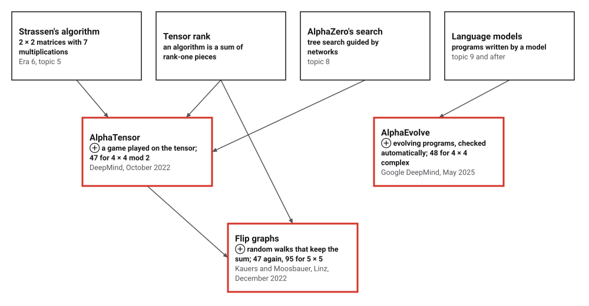
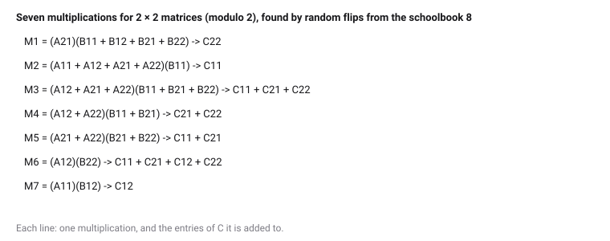
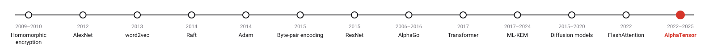
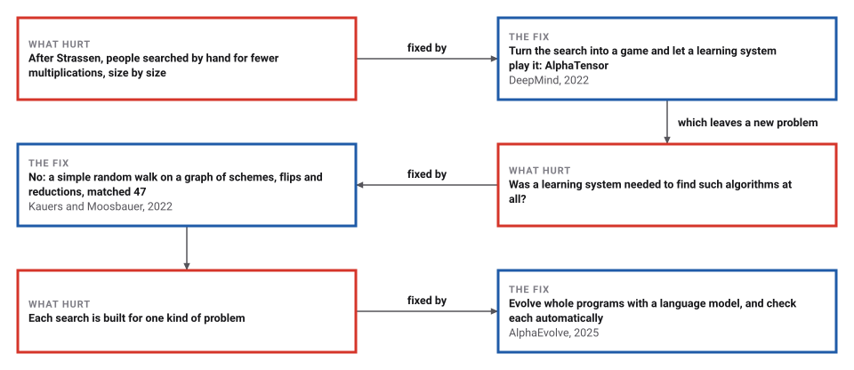
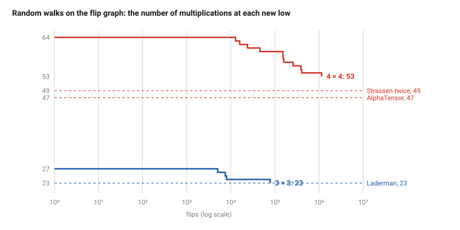

# Algorithms That Find Algorithms

*Era 9 · topic 13 · 2022–2025* · [Era 9 index](../README.md) · [← FlashAttention](../12-flashattention/README.md) · [Interactive edition](algorithms-that-find-algorithms.html) · [Program](../../../code/era-09-learning-at-scale/13-algorithms-that-find-algorithms/)

> **Field note from the visiting historian.** I gave the program DeepMind's 47 multiplications for 4 × 4 matrices, and it confirmed every one of them by adding up the pieces. Then I let it rewrite the schoolbook method at random, two pieces at a time. For 3 × 3 it arrived at 23 multiplications, Laderman's record of 1976, in 10 walks of ten. The species had begun to search for its algorithms with its algorithms.

| | |
|---|---|
| **When** | October 2022; December 2022; May 2025 |
| **Where** | DeepMind; J. Kepler University Linz; Google DeepMind |
| **What hurt** | An astronomically large space of algorithms, searched by hand |
| **The fix** | Algorithms as tensor decompositions, found by machine search and checked exactly |
| **Checked** | AlphaTensor's 47; 23 for 3 × 3 in 10 of 10 walks |

## How ideas combined

A new algorithm is usually an older idea combined with a new one. Strassen (Era 6) multiplied 2 × 2 matrices with 7 multiplications instead of 8. Every such algorithm is a way of writing one fixed table of zeros and ones, the matrix multiplication tensor, as a sum of simple pieces, one per multiplication. In 2022 DeepMind searched for short sums with a version of AlphaZero (topic 8); two months later two mathematicians in Linz matched its best result with a random walk; in 2025 a system that evolves programs with a language model joined the search.

<picture>
  <source media="(prefers-color-scheme: dark)" srcset="assets/family-dark.svg">
  
</picture>
*Red: three ways of searching for algorithms.*

## Walk the flip graph

Here is the schoolbook method for 2 × 2 matrices, written as 8 multiplications. A flip picks two rows that share a factor and rewrites them so that their sum stays the same; when two rows come to share two factors they merge, and the algorithm needs one multiplication fewer. Flip at random, or walk until a multiplication disappears. The check on the right adds up the rows after every step.

<picture>
  <source media="(prefers-color-scheme: dark)" srcset="assets/seven-dark.svg">
  
</picture>
*In the interactive edition you can walk the 2 × 2 flip graph yourself.*

## Era 9, learning at scale

<picture>
  <source media="(prefers-color-scheme: dark)" srcset="assets/era-timeline-dark.svg">
  
</picture>

## Each fix leaves a new pain

<picture>
  <source media="(prefers-color-scheme: dark)" srcset="assets/chain-dark.svg">
  
</picture>
*Read it as a snake: each new problem sits directly under the fix that exposed it.*

## An algorithm is a sum of pieces

**The tensor.** For n × n matrices, number the entries of A, B and C from 1 to n². The multiplication tensor T has a 1 at (entry (i, j) of A, entry (j, k) of B, entry (k, i) of the result) for every i, j, k, and 0 elsewhere: it lists which products of an A entry and a B entry contribute to which entry of the product.

**Pieces are multiplications.** A rank-one piece u ⊗ v ⊗ w says: form the sum of A's entries weighted by u, the sum of B's entries weighted by v, multiply them once, and add the product to C's entries as w says. If R pieces add up to T exactly, those R multiplications compute AB. The schoolbook method has n³ pieces; Strassen's has 7 for n = 2.

**Flips and reductions.** Two pieces that share a factor, a ⊗ b ⊗ c + a ⊗ b′ ⊗ c′, equal a ⊗ (b + b′) ⊗ c + a ⊗ b′ ⊗ (c′ − c): a flip, which changes the algorithm but not what it computes. If two pieces come to share two factors, a ⊗ b ⊗ c + a ⊗ b ⊗ c′ = a ⊗ b ⊗ (c + c′), and the algorithm loses a multiplication. Kauers and Moosbauer's method is a random walk of flips, taking every reduction it meets.

> **Key idea.** Make the search space precise and the answers checkable. Then any searcher, a learning system, a random walk or an evolving program, can propose algorithms, and a few lines of code can confirm them.

## Twenty-three, and forty-seven

**The classical schemes**, all with arithmetic modulo 2, each checked against T and on random 0/1 matrices: the schoolbook method for 2 × 2, 3 × 3 and 4 × 4 (8, 27 and 64 multiplications); Strassen's 7; and Strassen applied to 2 × 2 blocks of 2 × 2 blocks, 49 for 4 × 4. All correct.

**AlphaTensor's 47.** DeepMind published its algorithms as data. The program embeds the 47 pieces for 4 × 4 matrices modulo 2 (file factorizations_f2.npz, key 4,4,4) and checks them: they add up to T exactly, and they multiplied 10,000 random pairs of 0/1 matrices correctly; leave out the last piece and they no longer do. They use 450 nonzero coefficients against 432 for Strassen twice. The first of the 47 multiplications is (A13) x (B31).

**Flip graphs, 2 × 2.** Ten random walks from the schoolbook 8 all reached 7, after between 99 and 4,144 flips. One walk's 7 multiplications, found by random rewriting:

| # | Multiplication → added to |
|---|---|
| 1 | (A21)(B11 + B12 + B21 + B22) -> C22 |
| 2 | (A11 + A12 + A21 + A22)(B11) -> C11 |
| 3 | (A12 + A21 + A22)(B11 + B21 + B22) -> C11 + C21 + C22 |
| 4 | (A12 + A22)(B11 + B21) -> C21 + C22 |
| 5 | (A21 + A22)(B21 + B22) -> C11 + C21 |
| 6 | (A12)(B22) -> C11 + C21 + C12 + C22 |
| 7 | (A11)(B12) -> C12 |

**3 × 3.** Ten walks from the schoolbook 27: **10 of 10** reached 23 multiplications, Laderman's 1976 record, after between 15,212 and 91,709 flips. A few seconds of random flipping matches what took a mathematician's ingenuity.

**4 × 4.** One walk of 6,000,000 flips from the schoolbook 64 reached **53**: better than the schoolbook, but not Strassen twice (49) or AlphaTensor's 47. Kauers and Moosbauer report 47 over ℤ₂; this program's simple walk, with this budget, does not get there.

<picture>
  <source media="(prefers-color-scheme: dark)" srcset="assets/walks-dark.svg">
  
</picture>

## DeepMind, Linz, and DeepMind again

DeepMind, 5 October 2022: AlphaTensor is "the first artificial intelligence (AI) system for discovering novel, efficient, and provably correct algorithms"; it "builds upon AlphaZero" and treats the problem as a "single-player game"; "AlphaTensor's algorithm improves on Strassen's two-level algorithm in a finite field for the first time since its discovery 50 years ago"; it finds "up to thousands of matrix multiplication algorithms for each size". Wikipedia: for 4 × 4 over the two-element field, "47 multiplication operations, improving on the 49 operations".

Kauers and Moosbauer (Institute for Algebra, J. Kepler University Linz, 2 December 2022): a flip "can be done for any two rank-one tensors that share a common factor"; a reduction "always leads to a vertex belonging to a lower level"; "Starting from the standard algorithm we easily find schemes of rank 23, matching the record set by Laderman in 1976"; over ℤ₂ they matched 47 for 4 × 4 and found 95 for 5 × 5 "within seconds".

Google DeepMind, 14 May 2025: AlphaEvolve is "an evolutionary coding agent powered by large language models for general-purpose algorithm discovery and optimization", with "automated evaluators that verify answers"; it found a way to multiply 4 × 4 complex-valued matrices with "48 scalar multiplications"; on "over 50 open problems" it matched the best known solutions in about 75% and improved them in 20%.

## The search becomes the subject

This book has followed algorithms found by people, from tally marks onward. Its last topic is algorithms found by algorithms: tree search, random walks and evolving programs, each proposing, each checked by the oldest test there is, doing the arithmetic and comparing.

> **Full circle.** Strassen's trick saved one multiplication in eight. A random walk, knowing nothing but the rule for a flip, reached Laderman's 23 for 3 × 3 in 10 walks of 10.

## Before you read on

<details>
<summary><b>1.</b> How many entries does the 3 × 3 multiplication tensor have, and how many are 1?</summary>

9 × 9 × 9 = 729 entries; 27 of them are 1, one for each i, j, k.
</details>

<details>
<summary><b>2.</b> Apply a flip to a ⊗ b ⊗ c + a ⊗ b′ ⊗ c′. What do you get, and why is the sum unchanged?</summary>

a ⊗ (b + b′) ⊗ c + a ⊗ b′ ⊗ (c′ − c). Expanding gives a⊗b⊗c + a⊗b′⊗c + a⊗b′⊗c′ − a⊗b′⊗c: the middle terms cancel.
</details>

<details>
<summary><b>3.</b> Strassen applied twice to 4 × 4 uses how many multiplications? And to 8 × 8, three times?</summary>

7² = 49; 7³ = 343, against 512 for the schoolbook method.
</details>

<details>
<summary><b>4.</b> Why is a discovered algorithm easy to trust, even if the search is not?</summary>

Its pieces can be added up and compared with the tensor exactly, in a fraction of a second.
</details>

<details>
<summary><b>5.</b> Why does arithmetic modulo 2 matter for AlphaTensor's 47?</summary>

Its pieces were found and checked with 1 + 1 = 0; Wikipedia calls the result "restricted to mod 2 arithmetic". AlphaEvolve's 48 (2025) is for complex numbers, an improvement on Strassen's algorithm there.
</details>


## Where the evidence lives

| | Object | Where to see it | Licence |
|---|---|---|---|
| — | **AlphaTensor's algorithms, as data (2022)**. Google DeepMind, factorizations_f2.npz, CC BY 4.0. | [github.com/google-deepmind/alphatensor](https://github.com/google-deepmind/alphatensor) | Drawn placeholder. |
| — | **Flip Graphs for Matrix Multiplication (2022)**. Kauers and Moosbauer, arXiv:2212.01175. | [arXiv:2212.01175](https://arxiv.org/abs/2212.01175) | Drawn placeholder. |

## Every link was opened before it was listed

| Level | Link | Why |
|---|---|---|
| Start | [How AI Discovered a Faster Matrix Multiplication Algorithm](https://www.youtube.com/watch?v=fDAPJ7rvcUw) — Quanta Magazine | The story of AlphaTensor and the Linz response |
| Start | [Discovering novel algorithms with AlphaTensor](https://deepmind.google/blog/discovering-novel-algorithms-with-alphatensor/) — Google DeepMind (2022) | The announcement |
| Start | [AlphaEvolve: A Gemini-powered coding agent for designing advanced algorithms](https://deepmind.google/blog/alphaevolve-a-gemini-powered-coding-agent-for-designing-advanced-algorithms/) — Google DeepMind (2025) | The 2025 system |
| Deeper | [Matrix multiplication algorithm](https://en.wikipedia.org/wiki/Matrix_multiplication_algorithm) — Wikipedia | Where AlphaTensor's results sit among the records |
| Scholar | [Matej Balog - AlphaTensor: Discover faster matrix multiplication algorithms with RL - IPAM at UCLA](https://www.youtube.com/watch?v=QJT3LszR2pA) — Institute for Pure & Applied Mathematics (IPAM) | A talk by one of AlphaTensor's authors |
| Scholar | [Flip Graphs for Matrix Multiplication](https://arxiv.org/abs/2212.01175) — M. Kauers, J. Moosbauer (2022) | The random-walk method the program uses |
| Scholar | [AlphaTensor repository](https://github.com/google-deepmind/alphatensor) — Google DeepMind | The discovered algorithms, as data |

More, with certainty labels and the gaps we could not fill: [Era 9 reference catalog](https://github.com/vij658/AlgorithmEvolutionAtlas/blob/main/book/era-09-learning-at-scale/reference-catalog.md).

## The program behind every number here

[AlgorithmDiscovery.java](https://github.com/vij658/AlgorithmEvolutionAtlas/blob/main/code/era-09-learning-at-scale/13-algorithms-that-find-algorithms/AlgorithmDiscovery.java) makes **31 checks**: the schoolbook, Strassen and Strassen-twice schemes, AlphaTensor's 47 pieces against the tensor and on 10,000 random products, and every scheme the flip walks find. Run it with `java AlgorithmDiscovery.java` (JDK 17 or newer). The heart of it:

```java
/** Adds up the pieces modulo 2 and compares with the multiplication tensor. */
static boolean isMultiplication(List<int[]> S, int n) {
    int m = n * n;
    boolean[][][] t = new boolean[m][m][m];
    for (int[] x : S) for (int a = 0; a < m; a++) if ((x[0] >> a & 1) == 1) for (int b = 0; b < m; b++) if ((x[1] >> b & 1) == 1)
        for (int c = 0; c < m; c++) if ((x[2] >> c & 1) == 1) t[a][b][c] ^= true;
    for (int i = 0; i < n; i++) for (int j = 0; j < n; j++) for (int k = 0; k < n; k++) t[i * n + j][j * n + k][k * n + i] ^= true;
    for (boolean[][] p : t) for (boolean[] q : p) for (boolean z : q) if (z) return false;
    return true;
}

/** Walks from start until the rank reaches target or the flips run out; restarts after `patience` flips without a reduction. */
static List<int[]> walk(List<int[]> start, int target, long maxFlips, long patience, Random r, long[] flipsUsed, List<long[]> log) {
    List<int[]> S = copy(start), best = copy(start);
    long flips = 0, since = 0;
    int[] js = new int[start.size()];
    long tries = 0;
    while (best.size() > target && flips < maxFlips && tries++ < 1000 * maxFlips) { // the cap on tries stops a scheme with no possible flip
        int i = r.nextInt(S.size()), p = r.nextInt(3);
        int[] x = S.get(i);
        int cnt = 0;
        for (int j = 0; j < S.size(); j++) if (j != i && S.get(j)[p] == x[p]) js[cnt++] = j;
        if (cnt == 0) continue;
        int[] y = S.get(js[r.nextInt(cnt)]);
        int q = (p + 1) % 3, s = (p + 2) % 3;
        if (r.nextBoolean()) { int t = q; q = s; s = t; }
        // the flip: x = a(x)b(x)c, y = a(x)b'(x)c'  ->  a(x)(b+b')(x)c + a(x)b'(x)(c'+c), modulo 2
        x[q] ^= y[q]; y[s] ^= x[s];
        flips++; since++;
        Deque<int[]> touched = new ArrayDeque<>();
        touched.push(x); touched.push(y);
        if (reduce(S, touched) > 0) {
            since = 0;
            if (S.size() < best.size()) { best = copy(S); if (log != null) log.add(new long[]{flips, S.size()}); }
        }
        if (since > patience) { S = copy(start); since = 0; }
    }
    flipsUsed[0] = flips;
    return best;
}
```

