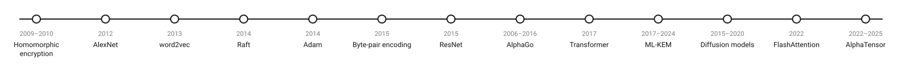
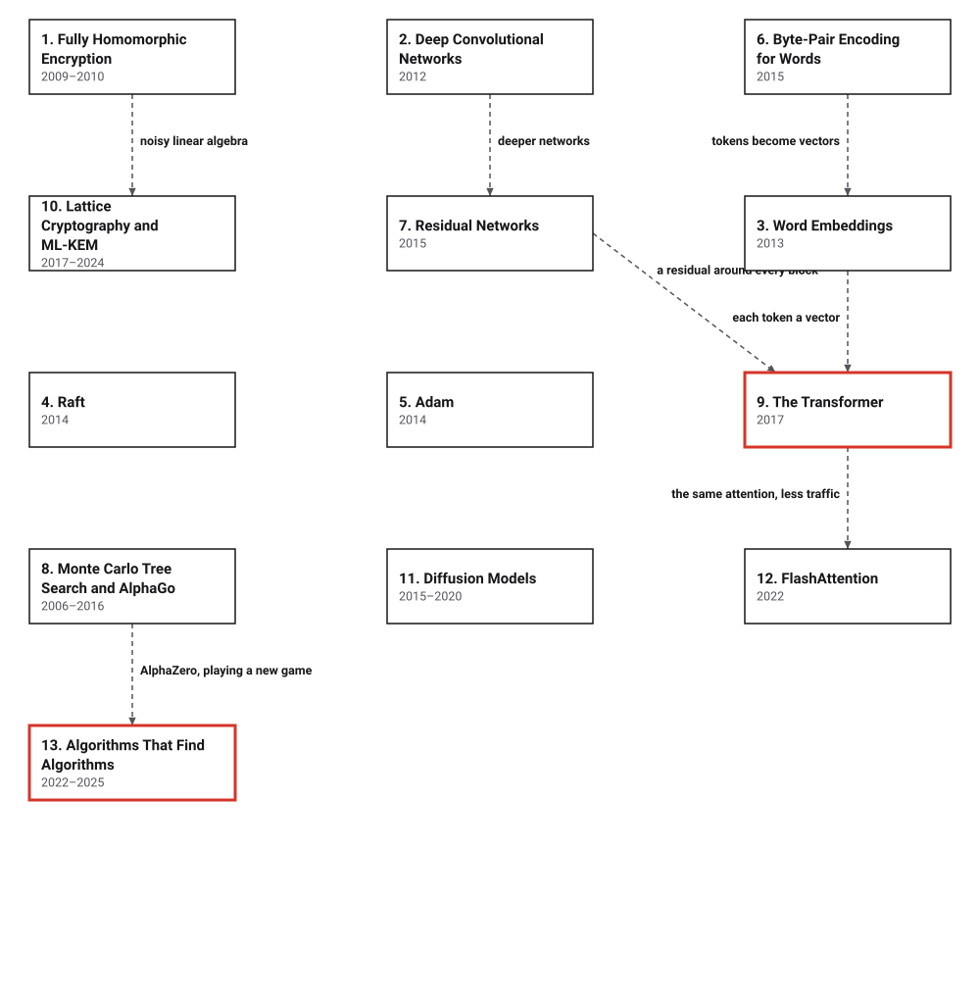

# Era 9 — Learning at Scale

*2009 to 2026* · [Book contents](../README.md) · [Interactive edition](index.html) · [Reference catalog](reference-catalog.md) · [Programs](../../code/era-09-learning-at-scale/README.md)

> **Field note from the visiting historian.** In the eighth era, the species built a Web, read its genome and agreed on a ledger. In this one an old idea, the network that learns from examples, suddenly works at scale, and much of the era's algorithmic work goes into making that learning possible; alongside it the species learns to compute on data it cannot read, prepares its cryptography for quantum computers, and sets its machines to search for algorithms.

## When

<picture>
  <source media="(prefers-color-scheme: dark)" srcset="assets/era-timeline-dark.svg">
  
</picture>

## How the ideas combined

<picture>
  <source media="(prefers-color-scheme: dark)" srcset="assets/era-map-dark.svg">
  
</picture>

*Dashed lines join related developments; none of them is a claim that one inventor learned from the other. Most boxes build on earlier eras: homomorphic encryption and ML-KEM on public-key cryptography (Era 6) and learning with errors; AlexNet, Adam and residual networks on backpropagation (Era 7) and the LSTM (Era 8); word vectors on Huffman's codes (Era 5) for their hierarchical softmax; Raft on Paxos (Era 8); byte-pair encoding on universal compression (Era 6); Monte Carlo tree search on Monte Carlo (Era 4); diffusion models on Markov chains (Era 4); the search for matrix multiplication algorithms on Strassen (Era 6).*

## The topics

| # | Topic | When | What hurt | Read |
|---|---|---|---|---|
| 1 | **Fully Homomorphic Encryption** | 2009; over the integers 2010 | Encrypted data had to be decrypted before anyone could compute with it | [page](01-homomorphic-encryption/README.md) · [interactive](01-homomorphic-encryption/homomorphic-encryption.html) · [program](../../code/era-09-learning-at-scale/01-homomorphic-encryption/README.md) |
| 2 | **Deep Convolutional Networks** | September 2012 | Hand-made image features had stalled; deep networks were too slow to train | [page](02-deep-convolutional-networks/README.md) · [interactive](02-deep-convolutional-networks/deep-convolutional-networks.html) · [program](../../code/era-09-learning-at-scale/02-deep-convolutional-networks/README.md) |
| 3 | **Word Embeddings** | January and October 2013 | Words were symbols with no notion of likeness | [page](03-word-embeddings/README.md) · [interactive](03-word-embeddings/word-embeddings.html) · [program](../../code/era-09-learning-at-scale/03-word-embeddings/README.md) |
| 4 | **Raft** | 2014 | Paxos was correct but hard to understand and to build | [page](04-raft/README.md) · [interactive](04-raft/raft.html) · [program](../../code/era-09-learning-at-scale/04-raft/README.md) |
| 5 | **Adam** | December 2014 | One learning rate for millions of very different parameters | [page](05-adam/README.md) · [interactive](05-adam/adam.html) · [program](../../code/era-09-learning-at-scale/05-adam/README.md) |
| 6 | **Byte-Pair Encoding for Words** | August 2015 | A fixed vocabulary cannot hold every word a translator will meet | [page](06-byte-pair-encoding/README.md) · [interactive](06-byte-pair-encoding/byte-pair-encoding.html) · [program](../../code/era-09-learning-at-scale/06-byte-pair-encoding/README.md) |
| 7 | **Residual Networks** | December 2015 | Deeper networks trained worse, not better | [page](07-residual-networks/README.md) · [interactive](07-residual-networks/residual-networks.html) · [program](../../code/era-09-learning-at-scale/07-residual-networks/README.md) |
| 8 | **Monte Carlo Tree Search and AlphaGo** | 2006; January and March 2016 | Go's game tree is too large to search, and its positions too hard to judge | [page](08-monte-carlo-tree-search/README.md) · [interactive](08-monte-carlo-tree-search/monte-carlo-tree-search.html) · [program](../../code/era-09-learning-at-scale/08-monte-carlo-tree-search/README.md) |
| 9 | **The Transformer** | June 2017 | Recurrent networks read one word at a time and forget the start of a sentence | [page](09-transformer/README.md) · [interactive](09-transformer/transformer.html) · [program](../../code/era-09-learning-at-scale/09-transformer/README.md) |
| 10 | **Lattice Cryptography and ML-KEM** | Kyber 2017; FIPS 203, 13 August 2024 | A quantum computer would break RSA and Diffie–Hellman | [page](10-lattice-cryptography/README.md) · [interactive](10-lattice-cryptography/lattice-cryptography.html) · [program](../../code/era-09-learning-at-scale/10-lattice-cryptography/README.md) |
| 11 | **Diffusion Models** | March 2015; June 2020 | Generating images by learning to destroy them | [page](11-diffusion-models/README.md) · [interactive](11-diffusion-models/diffusion-models.html) · [program](../../code/era-09-learning-at-scale/11-diffusion-models/README.md) |
| 12 | **FlashAttention** | May 2022 | Attention's table grows with the square of the text, and memory traffic, not arithmetic, was the bottleneck | [page](12-flashattention/README.md) · [interactive](12-flashattention/flashattention.html) · [program](../../code/era-09-learning-at-scale/12-flashattention/README.md) |
| 13 | **Algorithms That Find Algorithms** | October and December 2022; May 2025 | People had searched for faster matrix multiplication by hand for fifty years | planned · [references](reference-catalog.md#13-algorithms-that-find-algorithms) |

The interactive edition is a single HTML file per topic: download it and open it in a browser, or use the published copy linked from the [book contents](../README.md).
